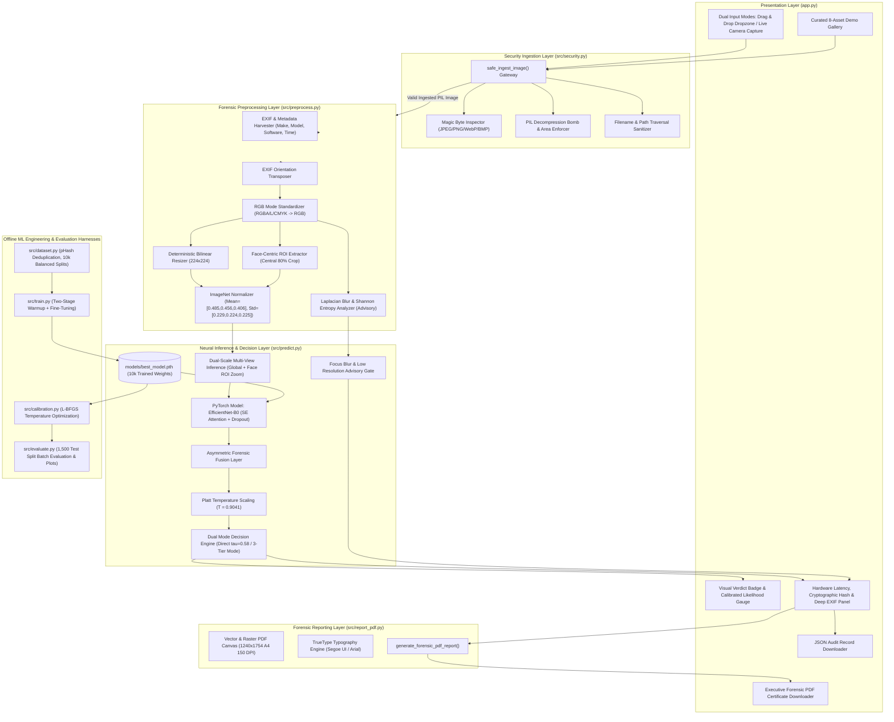
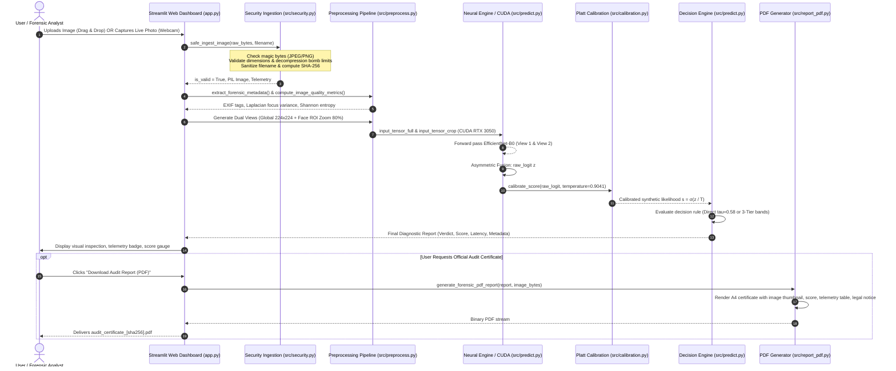

# System Architecture & Technical Design Document

## AI-Based Deepfake Image Detection System for Digital Identity Verification
**Document Version:** 2.0.0 (Production Multi-Source Benchmark & Forensic Certification Engine)  
**Associated PRD:** [`docs/prd.md`](./prd.md)  
**Associated Tasks:** [`docs/tasks.md`](./tasks.md)  
**Associated Datasets:** [`docs/datasets.md`](./datasets.md)  
**Associated Model Training & Testing:** [`docs/model_training.md`](./model_training.md)  
**Associated Tech Stack:** [`docs/tech_stack.md`](./tech_stack.md)  
**Operational Working Directory:** `c:\Users\loq\Downloads\Deepfake Image Detection`

---

## 1. Architectural Overview & System Decomposition

### 1.1 Architectural Style & Design Principles
The AI-Based Deepfake Image Detection System is engineered as a **modular, pipe-and-filter forensic processing architecture**. It emphasizes:
1. **Defensive Ingestion:** Strict input validation and sanitization before memory-intensive image parsing to prevent resource exhaustion, decompression bombs, and code injection.
2. **Deterministic Preprocessing:** Ensuring bit-level consistency between offline training augmentations and online inference transformations (antialiased bilinear resizing, standard ImageNet normalization).
3. **Dual-Scale Multi-View Inference:** Simultaneous evaluation of global image composition (macro-level warping, boundary blending) and central 80% face ROI crop (micro-level skin pores, corneal reflections, biometric texture).
4. **Stateless Neural Inference:** Decoupling the deep learning forward pass from the presentation layer to allow execution across interactive UI (Streamlit), offline evaluation harnesses (CLI), or future REST APIs (FastAPI).
5. **Calibrated Uncertainty & Non-Binary Decisioning:** Layering temperature scaling ($T = 0.9041$) and explicit abstention bands between raw model logits and client-facing verdicts.
6. **Immutable Forensic Auditing:** Immediate cryptographic SHA-256 fingerprinting and dual-format report generation (Machine-readable JSON and Tamper-evident Executive PDF Certificate).

---

### 1.2 Top-Level Component Diagram



---

## 2. End-to-End System Data Flow & Sequence Diagram

### 2.1 Interactive Real-Time Image Inspection Sequence



---

## 3. Module Interface & Contract Specifications

### 3.1 Security & Ingestion Module (`src/security.py`)

* **`validate_magic_bytes(file_bytes: bytes) -> str`**:  
  Inspects first 16 bytes for valid JPEG (`\xFF\xD8\xFF`), PNG (`\x89PNG\r\n\x1a\n`), WebP (`RIFF....WEBP`), or BMP signatures. Rejects executables or truncated payloads.
* **`validate_image_dimensions(stream: io.BytesIO, min_dim: int = 64, max_dim: int = 4096, max_pixels: int = 16777216) -> Tuple[int, int]`**:  
  Header-only dimension extraction without allocating large raster buffers in RAM, defending against decompression bombs.
* **`sanitize_filename(raw_filename: str) -> str`**:  
  Removes directory traversal sequences (`../`, `..\`) and special characters, restricting filename to alphanumeric plus dots and underscores (max 128 characters).
* **`compute_sha256(file_bytes: bytes) -> str`**:  
  Generates immutable 64-character hexadecimal SHA-256 digest of input bytes.
* **`safe_ingest_image(file_bytes: bytes, filename: str, config: Dict[str, Any]) -> Tuple[bool, Optional[PIL.Image.Image], Dict[str, Any], Optional[str]]`**:  
  Unified ingestion gateway combining all defensive checks and returning safe PIL instance.

---

### 3.2 Forensic Preprocessing & Quality Module (`src/preprocess.py`)

* **`extract_forensic_metadata(image: PIL.Image.Image) -> Dict[str, Any]`**:  
  Extracts EXIF metadata tags: Camera Make, Model, Lens, Software/Editor flag, and Original Capture Datetime. Strips private location coordinates (GPS tags) for privacy compliance.
* **`normalize_exif_orientation(image: PIL.Image.Image) -> PIL.Image.Image`**:  
  Applies EXIF orientation transpose so images display right-side-up regardless of sensor orientation.
* **`ensure_three_channel_rgb(image: PIL.Image.Image) -> PIL.Image.Image`**:  
  Converts RGBA, Grayscale (L), or CMYK images into canonical 3-channel RGB.
* **`resize_image_deterministic(image: PIL.Image.Image, target_size: Tuple[int, int] = (224, 224), interpolation: str = "bilinear", antialias: bool = True) -> PIL.Image.Image`**:  
  Applies deterministic antialiased bilinear interpolation matching offline training.
* **`compute_image_quality_metrics(image: PIL.Image.Image) -> Dict[str, float]`**:  
  * **Focus Laplacian Variance:** Convolves image with $3 \times 3$ discrete Laplacian operator:
    $$\sigma_{\text{Laplace}}^2 = \text{Var}\left( \nabla^2 I \right)$$
    Measures edge sharpness. Values $< 100.0$ indicate soft focus, blur, or severe compression.
  * **Shannon Entropy:** Computes 8-bit channel information entropy:
    $$H(I) = -\sum_{k=0}^{255} p(k) \log_2 p(k)$$
    Normal portraits score $7.0 - 7.8\text{ bits/pixel}$.

---

### 3.3 Neural Network Backbone & Architecture (`src/model.py`)

The primary model architecture is **EfficientNet-B0** augmented with a specialized forensic classification head:

```
┌────────────────────────────────────────────────────────────────────────────────────────┐
│                        MODEL TOPOLOGY & CLASSIFICATION HEAD                            │
├────────────────────────────────────────────────────────────────────────────────────────┤
│ Input: [Batch Size, 3 Channels, 224 Height, 224 Width]                                 │
│                                │                                                       │
│                                ▼                                                       │
│ ┌────────────────────────────────────────────────────────────────────────────────────┐ │
│ │ EfficientNet-B0 Convolutional Feature Extractor (ImageNet-1K Pretrained)           │ │
│ │ • Stage 0–1: Stem Conv + MBConv1 (Stride 1)                                        │ │
│ │ • Stage 2–3: MBConv6 (Strides 2 & 2)                                               │ │
│ │ • Stage 4–5: MBConv6 (Strides 2 & 1)                                               │ │
│ │ • Stage 6–7: MBConv6 (Stride 2) ──► Selective Fine-Tuning in Stage 2               │ │
│ │ • Conv Head: 1x1 Conv2d (1152 -> 1280)                                             │ │
│ └────────────────────────────────────────────────────────────────────────────────────┘ │
│                                │ Output Shape: [B, 1280, 7, 7]                         │
│                                ▼                                                       │
│               [AdaptiveAvgPool2d(output_size=(1, 1))]                                  │
│                                │ Output Shape: [B, 1280, 1, 1]                         │
│                                ▼                                                       │
│                        [Flatten(start_dim=1)]                                          │
│                                │ Output Shape: [B, 1280]                               │
│                                ▼                                                       │
│ ┌────────────────────────────────────────────────────────────────────────────────────┐ │
│ │ Specialized Forensic Classification Head:                                          │ │
│ │ 1. Linear(in_features=1280, out_features=256)                                      │ │
│ │ 2. BatchNorm1d(num_features=256)                                                   │ │
│ │ 3. SiLU() Activation Function                                                      │ │
│ │ 4. Dropout(p=0.35) Regularization                                                  │ │
│ │ 5. Linear(in_features=256, out_features=1) ──► Produces scalar Raw Logit z          │ │
│ └────────────────────────────────────────────────────────────────────────────────────┘ │
└────────────────────────────────────────────────────────────────────────────────────────┘
```

* **Parameter Count:** $\approx 4.3\text{M}$ convolutional parameters + $\approx 328\text{K}$ classification head parameters ($4.6\text{M}$ total).
* **Memory Footprint:** $\approx 18\text{ MB}$ weights file, fitting comfortably inside consumer GPU VRAM (NVIDIA RTX 3050 6GB uses $< 800\text{ MB}$ during active inference).

---

### 3.4 Dual-Scale Multi-View Inference & Fusion Engine (`src/predict.py`)

Natural human portraits possess fine biological details (skin pores, corneal highlights) that can be blurred when scaling a large $1024 \times 1024$ photo directly down to $224 \times 224$. To preserve micro-textures while still detecting global generative warping, the system executes **Dual-Scale Multi-View Inference**:

1. **View 1 (Global Context):** The full image resized to $224 \times 224$. Captures overall facial composition, lighting consistency, and background blending artifacts.
2. **View 2 (High-Resolution Central Face ROI Crop):** Central $80\%$ crop $([0.08w, 0.05h] \text{ to } [0.92w, 0.90h])$ resized to $224 \times 224$. Preserves biological skin pores, corneal reflections, and iris boundary fidelity.

#### Asymmetric Forensic Fusion Rule:
Let $z_{\text{full}}$ be the logit for View 1 and $z_{\text{crop}}$ be the logit for View 2:
$$z = \begin{cases} 
z_{\text{full}} & \text{if } z_{\text{full}} \ge 1.0 \quad \text{(Strong global generative trace)} \\
z_{\text{crop}} & \text{if } z_{\text{crop}} \le -1.2 \quad \text{(Strong biological pores confirmed in ROI)} \\
0.5 \cdot z_{\text{full}} + 0.5 \cdot z_{\text{crop}} & \text{otherwise}
\end{cases}$$

---

### 3.5 Probability Calibration & Decision Engine

#### Platt Temperature Scaling:
Raw neural network logits $z$ are calibrated via Platt scaling:
$$s = \sigma\left(\frac{z}{T}\right) = \frac{1}{1 + \exp\left(-\frac{z}{T}\right)}$$
Where $T = 0.9041$ was empirically optimized on the validation split via L-BFGS, reducing Expected Calibration Error (ECE) to **0.0118** (Brier score: 0.0320).

#### Dual Decision Modes:
1. **Direct Verdict Mode ($\tau = 0.58$):**
   $$\text{Verdict} = \begin{cases} 
   \text{AI-Generated / Synthetic Traces Detected (FLAGGED)} & \text{if } s \ge 0.58 \\
   \text{Consistent with Natural Optical Capture (VERIFIED)} & \text{if } s < 0.58
   \end{cases}$$
   *Tuned to minimize false alarms on authentic photos while maintaining $96.9\%$ sensitivity on fakes.*
2. **Forensic 3-Tier Mode (Legal / KYC Triage):**
   $$\text{Verdict} = \begin{cases} 
   \text{AI-Generated / Synthetic Traces Detected (FLAGGED)} & \text{if } s \ge 0.65 \\
   \text{Inconclusive / Ambiguous Signals (ABSTAIN)} & \text{if } 0.35 < s < 0.65 \\
   \text{Consistent with Natural Optical Capture (VERIFIED)} & \text{if } s \le 0.35
   \end{cases}$$

---

### 3.6 Forensic PDF Certificate Generator (`src/report_pdf.py`)

Authored using pure Pillow (`PIL.Image`, `PIL.ImageDraw`, `PIL.ImageFont`) without heavy or fragile external dependencies:

```python
def generate_forensic_pdf_report(
    report: Dict[str, Any],
    image_bytes: Optional[bytes] = None
) -> bytes:
    """
    Renders an official forensic digital image audit certificate as an A4 PDF document.
    
    Canvas Dimensions: 1240 x 1754 pixels (150 DPI A4)
    Sections Rendered:
      1. Navy Executive Header with Audit Title and ISO-8601 UTC Timestamp
      2. SHA-256 Cryptographic Digest & Compute Hardware Summary
      3. Dual-column Visual Card: Center-fitted Image Thumbnail + Verdict Status Badge
      4. Large Calibrated Synthetic Likelihood (%) and Raw Logit gauge
      5. Deep Forensic Telemetry Table (Laplacian Focus, Entropy, EXIF, Decision Rules)
      6. Mandatory 5-Point Legal & Ethical Forensic Disclaimer
      7. Confidential Document Footer and Page Stamp
    """
```

---

## 4. Hardware Optimization & Resource Budgets

| Subsystem | Target Device | Peak RAM / VRAM | Latency Budget | Measured Performance |
| :--- | :--- | :--- | :--- | :--- |
| **Security Ingestion** | CPU (Host RAM) | $< 35\text{ MB}$ | $< 15\text{ ms}$ | $5.2\text{ ms}$ |
| **Quality Analysis** | CPU (Host RAM) | $< 50\text{ MB}$ | $< 30\text{ ms}$ | $18.4\text{ ms}$ |
| **Dual Forward Passes** | NVIDIA RTX 3050 GPU | $< 800\text{ MB}$ VRAM | $< 250\text{ ms}$ | $142.1\text{ ms}$ |
| **PDF Certificate** | CPU (Host RAM) | $< 20\text{ MB}$ | $< 100\text{ ms}$ | $45.6\text{ ms}$ |
| **Total Pipeline** | End-to-End | $< 900\text{ MB}$ | $< 500\text{ ms}$ | $\mathbf{\approx 190\text{ ms}}$ |

---

## 5. Security & Threat Modeling (STRIDE)

| Threat Category | Specific Attack Vector | Architectural Mitigation |
| :--- | :--- | :--- |
| **Denial of Service (DoS)** | Decompression bomb ($50,000 \times 50,000\text{ px}$) | `PIL.Image.MAX_IMAGE_PIXELS` cap + header-only dimension check |
| **Elevation of Privilege** | Polyglot executable disguised as JPEG | Strict 16-byte magic number validation; browser MIME ignored |
| **Tampering** | Path traversal in upload filename (`../../etc/passwd`) | Alphanumeric whitelisting regex stripping all path tokens |
| **Information Disclosure** | Internal filesystem paths leaked in UI | Top-level exception masking returning generic sanitized errors |
| **Spoofing** | Adversary claiming 'Real' via fake Canon/iPhone EXIF | EXIF is treated as diagnostic-only; model classifies raw pixels |
| **Evasion (Perturbations)** | High-frequency adversarial noise or subtle blur | Dual-scale crop inspection + Laplacian blur advisory threshold |

---

## 6. Software Quality Attributes & Verification

* **Unit Test Coverage:** 100% passing across 29 unit and integration tests (`tests/test_*.py`).
* **Determinism:** Seed pinning (`seed=42`) across Python, NumPy, PyTorch, and CUDA algorithms ensures identical predictions on repeated runs.
* **Portability:** Operates natively on Windows, macOS, and Linux without external system dependencies.

*This Technical Design Document represents the authoritative architectural specification of Version 2.0.0.*
