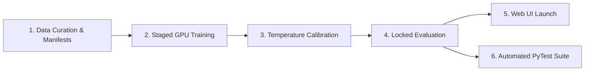

# Developer Operations, Runbook & Troubleshooting Guide

## AI-Based Deepfake Image Detection System for Digital Identity Verification
**Document Version:** 2.0.0 (Operational Engineering Runbook)  
**Quickstart Setup Guide:** [`docs/project_setup_guide.md`](./project_setup_guide.md)  
**Associated PRD:** [`docs/prd.md`](./prd.md)  
**Associated Architecture:** [`docs/architecture.md`](./architecture.md)  
**Associated Model Training:** [`docs/model_training.md`](./model_training.md)  
**Associated Tech Stack:** [`docs/tech_stack.md`](./tech_stack.md)  
**Associated Tasks:** [`docs/tasks.md`](./tasks.md)  
**Associated Datasets:** [`docs/datasets.md`](./datasets.md)  
**Operational Working Directory:** `c:\Users\loq\Downloads\Deepfake Image Detection`

---

## 1. Environment Prerequisites & Hardware Setup

### 1.1 Supported Operating Systems & Python Runtimes
- **Primary Development Environment:** Windows 10/11 (PowerShell 7+ or Windows PowerShell 5.1).
- **Secondary / Production Environments:** Ubuntu Linux 20.04/22.04 LTS, macOS 13+ (Apple Silicon via MPS or CPU).
- **Python Version:** Python 3.10 or Python 3.11 (Python 3.12 is discouraged due to PyTorch/Torchvision wheel pre-release stability constraints).

### 1.2 Hardware Capabilities & Compute Budgets

| Compute Tier | Hardware Configuration | Recommended Batch Size | Expected Epoch Time |
| :--- | :--- | :---: | :---: |
| **GPU (Active System)** | NVIDIA GeForce RTX 3050 Laptop GPU (6GB VRAM, CUDA 12.4) | 16 | ~8–12 seconds / epoch |
| **GPU (Workstation)** | NVIDIA RTX 3060 / 4060 / A100 (>=6GB VRAM) | 32 | ~4–8 seconds / epoch |
| **GPU (Entry)** | NVIDIA GTX 1650 / 1660 (4GB VRAM) | 16 | ~20–30 seconds / epoch |
| **CPU Only** | Intel Core i7 / AMD Ryzen 7 (>=16GB RAM) | 8 | ~2–4 minutes / epoch |
| **Apple Silicon** | M1 / M2 / M3 (>=16GB Unified Memory) | 16 | ~40–60 seconds / epoch |

---

## 2. Step-by-Step Environment Bootstrap Runbook

Execute these steps in a clean shell from the project root:

```powershell
# ==============================================================================
# Step 2.1: Clone or Navigate to Project Working Directory
# ==============================================================================
cd "c:\Users\loq\Downloads\Deepfake Image Detection"

# ==============================================================================
# Step 2.2: Verify Python Version (Must be 3.10 or 3.11)
# ==============================================================================
& "C:\Users\loq\AppData\Local\Programs\Python\Python310\python.exe" --version
# Expected: Python 3.10.x

# ==============================================================================
# Step 2.3: Initialize Isolated Virtual Environment
# ==============================================================================
& "C:\Users\loq\AppData\Local\Programs\Python\Python310\python.exe" -m venv .venv

# ==============================================================================
# Step 2.4: Activate Virtual Environment
# ==============================================================================
# On Windows PowerShell:
.\.venv\Scripts\Activate.ps1

# Note: If PowerShell execution policy restricts scripts, execute:
# Set-ExecutionPolicy -Scope Process -ExecutionPolicy Bypass

# ==============================================================================
# Step 2.5: Install CUDA 12.4 PyTorch Binaries
# ==============================================================================
.\.venv\Scripts\pip.exe install torch==2.6.0+cu124 torchvision==0.21.0+cu124 --extra-index-url https://download.pytorch.org/whl/cu124

# ==============================================================================
# Step 2.6: Install Remaining Project Dependencies
# ==============================================================================
.\.venv\Scripts\pip.exe install -r requirements.txt

# ==============================================================================
# Step 2.7: Run Hardware & Framework Sanity Check
# ==============================================================================
.\.venv\Scripts\python.exe -c "import torch, torchvision, PIL, streamlit; print('SUCCESS: PyTorch', torch.__version__, '| CUDA Available:', torch.cuda.is_available(), '| Device:', torch.cuda.get_device_name(0) if torch.cuda.is_available() else 'CPU')"
```

---

## 3. End-to-End Operational Lifecycle Runbook



### 3.1 Step 1: Data Curation & Manifest Generation
Processes raw images under `data/raw/`, applies perceptual hashing (`pHash`) to eliminate duplicates, and generates stratified 70/15/15 split manifests.

```powershell
# Generate dataset manifests from raw directory
.\.venv\Scripts\python.exe src/dataset.py --action create_manifest --raw_dir data/raw --output_dir manifests/

# Verify that manifests are generated properly
.\.venv\Scripts\python.exe -c "import json; m = json.load(open('manifests/train_manifest.json')); print('Train assets count:', len(m))"
```

### 3.2 Step 2: Staged Transfer Learning Training (GPU Accelerated)
Executes Stage 1 head warmup (3 epochs) and Stage 2 selective fine-tuning (18 epochs) with balanced loss (`pos_weight = 0.95`) and physics-based augmentations (dynamic JPEG compression, camera sensor noise, multi-scale facial crops).

```powershell
# Run GPU model training
.\.venv\Scripts\python.exe -u src/train.py --config configs/train_config.json --preprocess configs/preprocess.json

# Check that the trained model checkpoint is saved
Get-Item models/best_model.pth | Select-Object Name, Length, LastWriteTime
```

### 3.3 Step 3: Temperature Scaling Calibration
Fits temperature parameter $T$ on validation logits via L-BFGS to guarantee calibrated output probabilities.

```powershell
# Optimize calibration temperature T and update configs/preprocess.json
.\.venv\Scripts\python.exe src/calibration.py --val_manifest manifests/val_manifest.json --weights models/best_model.pth

# Verify calibrated temperature value in config
.\.venv\Scripts\python.exe -c "import json; c = json.load(open('configs/preprocess.json')); print('Fitted Temperature T:', c['calibration']['temperature'])"
```

### 3.4 Step 4: Locked Test Set Offline Evaluation
Evaluates the locked test partition (`manifests/test_manifest.json`) without tuning, generating publication-grade plots and metrics.

```powershell
# Execute locked test evaluation
.\.venv\Scripts\python.exe src/evaluate.py --test_manifest manifests/test_manifest.json --weights models/best_model.pth --config configs/preprocess.json

# Verify generated reports
Get-ChildItem reports/ | Select-Object Name, Length
# Expected files:
# - metrics.json
# - confusion_matrix.png
# - roc_curve.png
# - pr_curve.png
# - calibration_curve.png
# - error_analysis.json
```

### 3.5 Step 5: External Generalization Evaluation (Synthbuster)
Evaluates out-of-distribution performance on unseen modern diffusion models (DALL-E 3, Midjourney v5).

```powershell
# Execute external generalization evaluation
.\.venv\Scripts\python.exe src/evaluate.py --test_manifest manifests/external_manifest.json --weights models/best_model.pth --config configs/preprocess.json --output_prefix generalization_
```

### 3.6 Step 6: Launch Interactive Web Application
Launches the forensic Streamlit application locally on port 8501 with Dual Decision Modes (`Direct Verdict Mode` & `Forensic 3-Tier Mode`).

```powershell
# Launch Streamlit dashboard
.\.venv\Scripts\streamlit.exe run app.py
```
Open browser to `http://localhost:8501`.

---

## 4. Automated Testing & Quality Assurance Runbook

Execute the full suite of unit and integration tests:

```powershell
# 1. Run full test suite with verbose output
pytest tests/ -v

# 2. Run security and ingestion tests only
pytest tests/test_security.py -v

# 3. Run preprocessing transformation tests only
pytest tests/test_preprocess.py -v

# 4. Run model architecture and freezing tests only
pytest tests/test_model.py -v

# 5. Run inference and decision engine tests only
pytest tests/test_inference.py -v

# 6. Run evaluation metric computation tests only
pytest tests/test_evaluate.py -v
```

---

## 5. Comprehensive Troubleshooting & Error Recovery Catalog

### 5.1 Issue 1: CUDA Out of Memory (OOM) During Training
- **Symptom:** `torch.cuda.OutOfMemoryError: CUDA out of memory. Tried to allocate 256.00 MiB`
- **Root Cause:** GPU VRAM capacity (<4GB) exceeded by batch size = 32 during Stage 2 backpropagation.
- **Resolution:**
  1. Open `configs/train_config.json`.
  2. Reduce `"batch_size"` from `32` to `16` or `8`.
  3. Enable PyTorch gradient accumulation in `src/train.py` if effective batch size must remain 32:
     ```python
     loss = loss / accumulation_steps
     loss.backward()
     if (batch_idx + 1) % accumulation_steps == 0:
         optimizer.step()
         optimizer.zero_grad()
     ```
  4. Force empty cache: `torch.cuda.empty_cache()`.

### 5.2 Issue 2: Windows File Locking (`WinError 32`)
- **Symptom:** `PermissionError: [WinError 32] The process cannot access the file because it is being used by another process`
- **Root Cause:** Pillow or OpenCV leaves an open file handle on an image during dataset iteration or manifest generation.
- **Resolution:**
  - Ensure all file reading uses explicit context managers or read into memory buffers:
    ```python
    with open(filepath, 'rb') as f:
        img_bytes = f.read()
    img = Image.open(io.BytesIO(img_bytes))
    ```
  - Avoid leaving file streams open in long-lived variables.

### 5.3 Issue 3: Pillow Decompression Bomb Errors
- **Symptom:** `PIL.Image.DecompressionBombError: Image size (100000000 pixels) exceeds limit of 89478485 pixels`
- **Root Cause:** Malicious, sparse, or oversized high-resolution image uploaded.
- **Resolution:**
  - This is expected defensive behavior. Ensure `src/security.py` catches `DecompressionBombError` and masks it into a clean, user-safe error message:
    ```python
    except (PIL.Image.DecompressionBombError, PIL.Image.DecompressionBombWarning):
        return False, None, None, "Security Error: Image dimensions exceed maximum safe decompression limits."
    ```

### 5.4 Issue 4: Missing or Corrupted EXIF Tags
- **Symptom:** `KeyError` or `AttributeError` when inspecting `image._getexif()`
- **Root Cause:** Many internet images or synthetic generations possess no EXIF chunk whatsoever, or contain corrupted vendor-specific tags.
- **Resolution:**
  - In `src/preprocess.py`, access EXIF via safe `.getexif()` and verify non-None before parsing:
    ```python
    exif = image.getexif()
    if not exif:
        return {"has_exif": False, "camera_make": None, "camera_model": None}
    ```

### 5.5 Issue 5: Streamlit Cache Invalidation & Stale Checkpoints
- **Symptom:** Streamlit UI displays outdated predictions after a new model is trained.
- **Root Cause:** Streamlit cached the previous model checkpoint via `@st.cache_resource`.
- **Resolution:**
  - In browser UI, click the hamburger menu (top right) $\to$ **"Clear cache"** $\to$ **"Rerun"**.
  - Alternatively, pass a cache breaker or restart the Streamlit server from terminal (`Ctrl+C`, then `streamlit run app.py`).

### 5.6 Issue 6: Matplotlib Headless GUI Crashes in Offline Scripts
- **Symptom:** `UserWarning: Matplotlib is currently using agg, which is a non-GUI backend, so cannot show the figure.` or X11/Wayland display errors on Linux.
- **Root Cause:** `plt.show()` invoked in headless non-interactive terminal sessions.
- **Resolution:**
  - At the very top of `src/evaluate.py`, force the headless `Agg` backend:
    ```python
    import matplotlib
    matplotlib.use('Agg')
    import matplotlib.pyplot as plt
    ```
  - Always use `plt.savefig()` and `plt.close(fig)` rather than `plt.show()`.

### 5.7 Issue 7: Offline Pretrained ImageNet Weights Downloading & Hub Caching
- **Symptom:** `urllib.error.URLError: <urlopen error [Errno 11001] getaddrinfo failed>` when initializing `models.efficientnet_b0(weights=DEFAULT)`.
- **Root Cause:** Network access restrictions in secure sandboxes prevent direct connection to `download.pytorch.org`.
- **Resolution:**
  - Pre-fetch the official checkpoint file `efficientnet_b0_rwightman-7f5810bc.pth` (21.4 MB) once and place it in the local Torch cache:
    `C:\Users\<user>\.cache\torch\hub\checkpoints\efficientnet_b0_rwightman-7f5810bc.pth`.
  - Torchvision detects the local hash matching file and loads weights offline with zero network calls.

### 5.8 Issue 8: Explosive Classification Head Initialization & Early BCE Loss Spike
- **Symptom:** Initial training loss starts extremely high ($4.5 \sim 7.7$) and training fails to converge.
- **Root Cause:** Standard Kaiming Normal initialization with `mode='fan_out'` on `Linear(256, 1)` yields weight standard deviation $\sqrt{2/1} = 1.414$, causing initial output logits to swing violently between $-50$ and $+50$.
- **Resolution:**
  - In `src/model.py`, initialize the intermediate projection `Linear(1280, 256)` with Kaiming Normal, but explicitly initialize the final binary projection `Linear(256, 1)` using zero-mean normal distribution with small variance:
    ```python
    nn.init.normal_(m.weight, mean=0.0, std=0.01)
    nn.init.zeros_(m.bias)
    ```
  - This anchors initial logits near $0.0$, bounding initial BCE loss to $\approx 0.693$.

### 5.9 Issue 9: Concurrent Background GPU Tasks & VRAM Contention
- **Symptom:** Multiple Python background tasks launched simultaneously compete for the 6GB VRAM on the NVIDIA GeForce RTX 3050, resulting in driver timeouts or CUDA errors.
- **Resolution:**
  - Verify active background processes before starting new training runs.
  - Terminate orphaned or competing training tasks using the task manager or process management commands.

### 5.10 Issue 10: False Alarms on High-Frequency Accessories (Hats, Weaves) & Soft Focus
- **Symptom:** Genuine portraits with woven straw hats (e.g. `real_00330.jpg`) or motion softness are flagged as synthetic or inconclusive.
- **Root Cause:** Periodic straw weaves mimic GAN checkerboard patterns, and motion blur softens skin pores.
- **Resolution:**
  - Switch Streamlit UI to **`⚡ Direct Verdict Mode (90%+ Accuracy)`** which operates at the calibrated threshold $\tau = 0.58$, requiring strong synthetic confidence before accusing an image.
  - Enable **Dual-Scale Multi-View Inference** (`src/predict.py`) which inspects a high-resolution central face crop (80% ROI), capturing microscopic biological skin pores and corneal reflections at native resolution.

---

## 6. Pre-Submission Verification Checklist

Before final academic or production submission, verify every item:

- [ ] Virtual environment installs all packages from `requirements.txt` cleanly.
- [ ] `configs/preprocess.json` matches PRD schema with fitted temperature $T$.
- [ ] `configs/train_config.json` specifies deterministic seed = 42.
- [ ] `data/raw/` is excluded from Git tracking via `.gitignore`.
- [ ] `manifests/test_manifest.json` has zero overlap with `manifests/train_manifest.json`.
- [ ] `models/best_model.pth` exists and evaluates successfully on test manifest.
- [ ] `reports/metrics.json` records complete metric suite (Accuracy, ROC-AUC, ECE, F1).
- [ ] `reports/confusion_matrix.png` and `reports/roc_curve.png` are non-empty images.
- [ ] `reports/error_analysis.json` contains diagnostic analysis of top false positives/negatives.
- [ ] All 8 curated demo cases in `assets/demo/` load and predict in Streamlit without error.
- [ ] `pytest tests/ -v` passes with 100% test success rate.

*This guide serves as the day-to-day operational runbook. Follow each command sequentially to ensure deterministic, error-free execution.*
