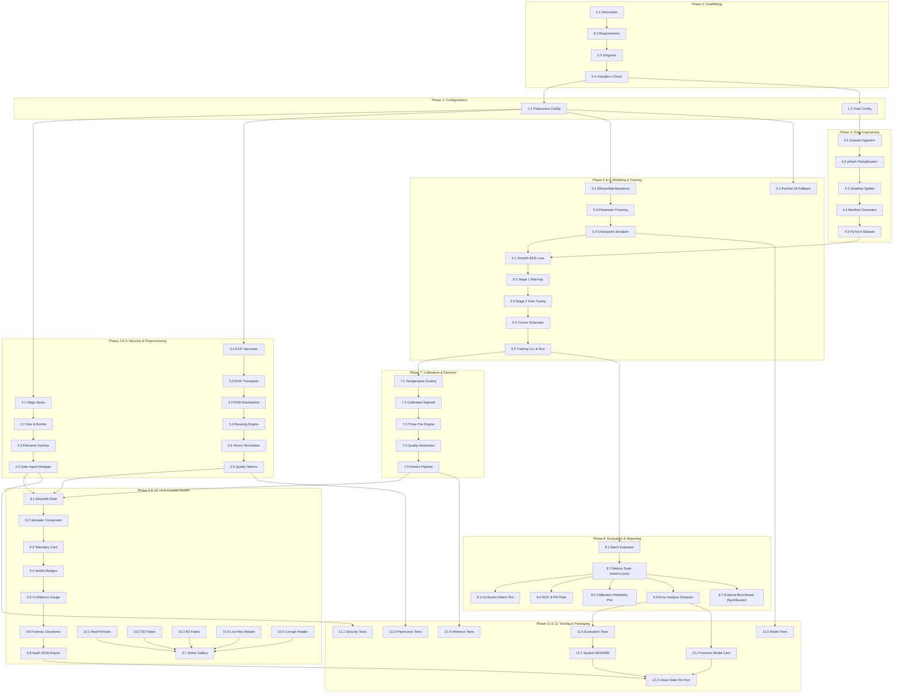

# Implementation Tasks: AI-Based Deepfake Image Detection System

**Document Version:** 1.0.0  
**Associated PRD:** [`docs/prd.md`](./prd.md)  
**System Classification:** Academic Machine Learning Prototype / Digital Forensics Diagnostic Tool  
**Operational Working Directory:** `c:\Users\loq\Downloads\Deepfake Image Detection`  
**Tracking Legend:**
- `[ ]` **Pending:** Not yet started
- `[/]` **In Progress:** Actively being implemented
- `[X]` **Completed:** Implemented, verified, and passing acceptance criteria

---

## Progress Summary Matrix

| Phase | Milestone Description | Total Tasks | Completed | Status |
| :--- | :--- | :---: | :---: | :---: |
| **Phase 0** | Project Scaffolding & Environment Initialization | 4 | 4 | `[X]` Completed |
| **Phase 1** | Configuration Management & System Specifications | 2 | 2 | `[X]` Completed |
| **Phase 2** | Ingestion Security & Memory Protection Module | 4 | 4 | `[X]` Completed |
| **Phase 3** | Metadata Harvesting & Forensic Preprocessing Engine | 6 | 6 | `[X]` Completed |
| **Phase 4** | Data Engineering, Acquisition & Manifest Pipeline | 5 | 5 | `[X]` Completed |
| **Phase 5** | Deep Learning Model Architecture | 4 | 4 | `[X]` Completed |
| **Phase 6** | Model Training & Fine-Tuning Pipeline | 5 | 5 | `[X]` Completed |
| **Phase 7** | Post-Processing Calibration & Decision Engine | 5 | 5 | `[X]` Completed |
| **Phase 8** | Offline Evaluation, Metrics Suite & Visual Reporting | 7 | 7 | `[X]` Completed |
| **Phase 9** | Interactive Forensic Web Dashboard (Streamlit) | 8 | 8 | `[X]` Completed |
| **Phase 10** | Curated Demo Assets & Edge Case Test Suite | 5 | 5 | `[X]` Completed |
| **Phase 11** | Automated Test Suite & Quality Assurance | 5 | 5 | `[X]` Completed |
| **Phase 12** | Documentation, Model Card & Submission Packaging | 3 | 3 | `[X]` Completed |
| **Phase 13** | GPU Acceleration, Forensic Augmentations & Multi-Scale Engine | 6 | 6 | `[X]` Completed |
| **Phase 14** | Constraint Simulation Suite & Multi-Source Benchmark Expansion | 6 | 6 | `[X]` Completed |
| **Phase 15** | Live Camera Capture & Executive PDF Audit Certification | 3 | 3 | `[X]` Completed |
| **Total** | **End-to-End Delivery Scope** | **78** | **78** | **100% Complete** |

---

## Phase 0: Project Scaffolding & Environment Initialization

### Task 0.1: Directory Tree & Workspace Initialization
- **ID:** `TASK-00.1`
- **PRD Reference:** Section 6.6 (FR-28, FR-29), Section 8.3
- **Objective:** Create the standardized canonical project directory hierarchy on disk to isolate source code, configurations, data manifests, model weights, evaluation reports, assets, and tests.
- **Actions Required:**
  1. Create directory `configs/`
  2. Create directory `src/`
  3. Create directory `data/raw/` (with `.gitkeep`)
  4. Create directory `data/processed/` (with `.gitkeep`)
  5. Create directory `manifests/`
  6. Create directory `models/` (with `.gitkeep`)
  7. Create directory `reports/failures/`
  8. Create directory `assets/demo/`
  9. Create directory `tests/`
- **Target Files:**
  - `configs/`
  - `src/`
  - `data/raw/.gitkeep`
  - `data/processed/.gitkeep`
  - `manifests/`
  - `models/.gitkeep`
  - `reports/failures/`
  - `assets/demo/`
  - `tests/`
- **Verification Command:**
  ```powershell
  Test-Path configs, src, data/raw, data/processed, manifests, models, reports/failures, assets/demo, tests
  ```
- **Acceptance Criteria:** All target directories exist on disk and return `True`.
- **Status:** `[X]` Completed

---

### Task 0.2: Pinned Dependency Tree Specification
- **ID:** `TASK-00.2`
- **PRD Reference:** Section 7.5, Section 13.3
- **Objective:** Author the pinned `requirements.txt` locking exact library versions for PyTorch, Torchvision, Pillow, OpenCV-headless, Scikit-learn, Streamlit, Matplotlib, Seaborn, and PyTest, maintaining cross-platform compatibility (Windows, Linux, macOS).
- **Actions Required:**
  1. Write `requirements.txt` with locked versions:
     - `torch==2.2.2`
     - `torchvision==0.17.2`
     - `numpy==1.26.4`
     - `scipy==1.12.0`
     - `scikit-learn==1.4.1.post1`
     - `pandas==2.2.1`
     - `Pillow==10.2.0`
     - `imagehash==4.3.1`
     - `piexif==1.1.3`
     - `opencv-python-headless==4.9.0.80`
     - `matplotlib==3.8.3`
     - `seaborn==0.13.2`
     - `streamlit==1.32.0`
     - `pytest==8.1.1`
     - `tqdm==4.66.2`
- **Target Files:**
  - `requirements.txt`
- **Verification Command:**
  ```powershell
  Get-Content requirements.txt | Select-String "torch==", "streamlit==", "Pillow=="
  ```
- **Acceptance Criteria:** `requirements.txt` is created with exact pinned package constraints matching PRD Section 13.3.
- **Status:** `[X]` Completed

---

### Task 0.3: Repository Governance & Security Exclusions
- **ID:** `TASK-00.3`
- **PRD Reference:** Section 3.2, Section 7.3, Section 8.3
- **Objective:** Configure `.gitignore` to prevent leakage of raw datasets, user uploads, private images, temporary cache files, virtual environments, and large binary artifacts into version control.
- **Actions Required:**
  1. Create `.gitignore` containing:
     - Python cache (`__pycache__/`, `*.py[cod]`, `*$py.class`)
     - Virtual environments (`venv/`, `.venv/`, `env/`)
     - Raw and processed training datasets (`data/raw/*`, `data/processed/*`, `!data/raw/.gitkeep`, `!data/processed/.gitkeep`)
     - Model weights binaries (`models/*.pth`, `models/*.pt`, `models/*.onnx`, `!models/.gitkeep`)
     - Temporary evaluation failures and scratch files (`reports/failures/*`, `reports/*.png`, `scratch/`)
     - OS artifacts (`.DS_Store`, `Thumbs.db`, `desktop.ini`)
     - IDE artifacts (`.vscode/`, `.idea/`)
- **Target Files:**
  - `.gitignore`
- **Verification Command:**
  ```powershell
  Get-Content .gitignore | Select-String "data/raw", "models/\*.pth", "__pycache__"
  ```
- **Acceptance Criteria:** Git status confirms binary files and dataset directories are ignored.
- **Status:** `[X]` Completed

---

### Task 0.4: Virtual Environment & Toolchain Verification
- **ID:** `TASK-00.4`
- **PRD Reference:** Section 7.5, Section 13.4
- **Objective:** Verify Python 3.10/3.11 environment, initialize virtual environment, and install dependencies to establish a working execution environment.
- **Actions Required:**
  1. Create Python virtual environment (`python -m venv venv`).
  2. Activate virtual environment.
  3. Install dependencies via `pip install -r requirements.txt`.
  4. Execute sanity check importing `torch`, `torchvision`, `PIL`, and `streamlit`.
- **Target Files:**
  - `venv/`
- **Verification Command:**
  ```powershell
  python -c "import torch, torchvision, PIL, streamlit; print('Environment OK: PyTorch', torch.__version__, 'CUDA Available:', torch.cuda.is_available())"
  ```
- **Acceptance Criteria:** Python script prints `Environment OK: PyTorch 2.2.2` without import errors.
- **Status:** `[X]` Completed

---

## Phase 1: Configuration Management & System Specifications

### Task 1.1: Preprocessing & Hardware Configuration
- **ID:** `TASK-01.1`
- **PRD Reference:** Section 4.4, Section 4.7, Section 6.6 (FR-29), Section 13.1
- **Objective:** Author the central preprocessing configuration file `configs/preprocess.json` defining target image dimensions, normalization constants, calibration temperature, decision thresholds, and security bounds.
- **Actions Required:**
  1. Write `configs/preprocess.json` matching PRD schema:
     - `model_architecture`: `"efficientnet_b0"`
     - `checkpoint_path`: `"models/best_model.pth"`
     - `input_resolution`: `[224, 224]`
     - `interpolation`: `"bilinear"`
     - `antialias`: `true`
     - `normalization`: `mean: [0.485, 0.456, 0.406]`, `std: [0.229, 0.224, 0.225]`
     - `calibration`: `temperature: 1.0`, `method`: `"platt_scaling_validation"`
     - `decision_thresholds`: `real_upper_bound: 0.35`, `fake_lower_bound: 0.65`, `abstention_enabled: true`
     - `class_mapping`: `{"0": "Real / Authentic Consistent", "1": "AI-Generated / Synthetic"}`
     - `security_limits`: `max_file_size_bytes: 15728640`, `min_dimension_px: 64`, `max_dimension_px: 4096`, `max_image_pixels: 16777216`, `blur_variance_threshold: 100.0`
- **Target Files:**
  - `configs/preprocess.json`
- **Verification Command:**
  ```powershell
  python -c "import json; conf = json.load(open('configs/preprocess.json')); assert conf['input_resolution'] == [224, 224]; assert conf['decision_thresholds']['fake_lower_bound'] == 0.65; print('Preprocess Config Valid')"
  ```
- **Acceptance Criteria:** JSON parses cleanly and contains all mandatory configuration keys.
- **Status:** `[X]` Completed

---

### Task 1.2: Training Hyperparameter Configuration
- **ID:** `TASK-01.2`
- **PRD Reference:** Section 4.3, Section 4.5, Section 4.6
- **Objective:** Author the training configuration file `configs/train_config.json` establishing reproducibility seeds, staged learning rates, batch sizes, optimizer parameters, early stopping limits, and label smoothing epsilon.
- **Actions Required:**
  1. Write `configs/train_config.json` defining:
     - `seed`: `42`
     - `batch_size`: `32`
     - `num_workers`: `2`
     - `stage1_epochs`: `2` (warmup classification head)
     - `stage1_lr`: `0.001`
     - `stage2_epochs`: `6` (selective unfreeze)
     - `stage2_backbone_lr`: `0.00005`
     - `stage2_head_lr`: `0.0002`
     - `optimizer`: `"adamw"`
     - `weight_decay`: `0.0001`
     - `label_smoothing`: `0.05`
     - `patience`: `3`
     - `monitor_metric`: `"val_macro_f1"`
- **Target Files:**
  - `configs/train_config.json`
- **Verification Command:**
  ```powershell
  python -c "import json; conf = json.load(open('configs/train_config.json')); assert conf['seed'] == 42; assert conf['stage1_epochs'] == 2; print('Train Config Valid')"
  ```
- **Acceptance Criteria:** JSON parses cleanly and specifies two-stage training hyperparameters.
- **Status:** `[X]` Completed

---

## Phase 2: Ingestion Security & Memory Protection Module

### Task 2.1: Binary Magic Byte Inspector
- **ID:** `TASK-02.1`
- **PRD Reference:** Section 6.1 (FR-01, FR-04), Section 7.2
- **Objective:** Implement `validate_magic_bytes(file_bytes: bytes) -> str` in `src/security.py` to inspect the initial 16 bytes of any upload and verify pure JPEG (`FF D8 FF`) or PNG (`89 50 4E 47 0D 0A 1A 0A`) signatures, completely discarding client-provided MIME headers and extensions.
- **Actions Required:**
  1. Create `src/security.py`.
  2. Implement custom exception classes: `SecurityValidationError(Exception)` and `MalformedFileError(SecurityValidationError)`.
  3. Implement `validate_magic_bytes`:
     - If bytes start with `b'\xff\xd8\xff'`: return `'JPEG'`
     - If bytes start with `b'\x89PNG\r\n\x1a\n'`: return `'PNG'`
     - Else: raise `MalformedFileError("File signature does not match permitted image formats (JPEG, PNG).")`
- **Target Files:**
  - `src/security.py`
- **Verification Command:**
  ```powershell
  python -c "from src.security import validate_magic_bytes, MalformedFileError; assert validate_magic_bytes(b'\xff\xd8\xff\xe0') == 'JPEG'; assert validate_magic_bytes(b'\x89PNG\r\n\x1a\n\x00') == 'PNG'; print('Magic Byte Validation OK')"
  ```
- **Acceptance Criteria:** Correctly identifies JPEG and PNG headers; rejects non-matching signatures with `MalformedFileError`.
- **Status:** `[X]` Completed

---

### Task 2.2: Decompression Bomb & Dimensional Boundary Enforcement
- **ID:** `TASK-02.2`
- **PRD Reference:** Section 6.1 (FR-02, FR-03), Section 7.2, Section 9 (Case 1)
- **Objective:** Implement `validate_image_dimensions(stream: io.BytesIO, max_pixels: int = 16777216, min_dim: int = 64, max_dim: int = 4096) -> Tuple[int, int]` in `src/security.py` to inspect dimensions via header decoding without calling `.load()`, and validate file size limits ($1\text{ KB} \le \text{size} \le 15\text{ MB}$).
- **Actions Required:**
  1. Set `PIL.Image.MAX_IMAGE_PIXELS = 16777216` globally in `src/security.py`.
  2. Implement `validate_file_size(file_bytes: bytes, min_bytes: int = 1024, max_bytes: int = 15728640)`.
  3. Implement `validate_image_dimensions` reading `Image.open(stream)` header:
     - Check $W \ge \text{min\_dim}$ and $H \ge \text{min\_dim}$.
     - Check $W \le \text{max\_dim}$ and $H \le \text{max\_dim}$.
     - Check $W \times H \le \text{max\_pixels}$.
     - Reset stream pointer `stream.seek(0)`.
- **Target Files:**
  - `src/security.py`
- **Verification Command:**
  ```powershell
  python -c "import io; from PIL import Image; from src.security import validate_image_dimensions; buf = io.BytesIO(); Image.new('RGB', (100, 100)).save(buf, format='PNG'); buf.seek(0); dims = validate_image_dimensions(buf); assert dims == (100, 100); print('Dimension Validation OK')"
  ```
- **Acceptance Criteria:** Validates allowable image dimensions; rejects micro-images ($<64\text{px}$) and oversized images ($>4096\text{px}$).
- **Status:** `[X]` Completed

---

### Task 2.3: Safe Filename Sanitization & Path Traversal Prevention
- **ID:** `TASK-02.3`
- **PRD Reference:** Section 6.1 (FR-04), Section 7.2
- **Objective:** Implement `sanitize_filename(raw_filename: str) -> str` in `src/security.py` using strict alphanumeric whitelisting and path normalization to prevent directory traversal (`../../etc/passwd`).
- **Actions Required:**
  1. Implement regex sanitization stripping path separators (`/`, `\`), null bytes (`\0`), and shell metacharacters.
  2. Restrict allowed characters to `[a-zA-Z0-9_.-]`.
  3. Truncate basename to maximum 128 characters.
  4. Provide fallback default `"unnamed_image.jpg"` if input is empty or invalid.
- **Target Files:**
  - `src/security.py`
- **Verification Command:**
  ```powershell
  python -c "from src.security import sanitize_filename; assert sanitize_filename('../../etc/passwd.jpg') == 'passwd.jpg'; assert sanitize_filename('test#$@ 1.png') == 'test_1.png'; print('Filename Sanitization OK')"
  ```
- **Acceptance Criteria:** Filenames stripped of path traversal sequences and unsafe symbols.
- **Status:** `[X]` Completed

---

### Task 2.4: Comprehensive Exception Masking & Structured Error Responses
- **ID:** `TASK-02.4`
- **PRD Reference:** Section 6.1 (FR-05), Section 7.2
- **Objective:** Implement `safe_ingest_image(raw_bytes: bytes, filename: str, config: dict) -> Tuple[bool, Optional[PIL.Image.Image], Optional[dict], Optional[str]]` in `src/security.py` orchestrating validation and returning clean error diagnostics without leaking internal stack traces.
- **Actions Required:**
  1. Wrap file size validation, magic byte validation, and dimensional checks in a top-level try/except block.
  2. Trap `PIL.UnidentifiedImageError`, `PIL.Image.DecompressionBombError`, `MemoryError`, and `SecurityValidationError`.
  3. Return a standardized tuple: `(is_valid, image_obj, telemetry_dict, error_message)`.
  4. Compute SHA-256 hash of `raw_bytes` and attach to `telemetry_dict`.
- **Target Files:**
  - `src/security.py`
- **Verification Command:**
  ```powershell
  python -c "import json; from src.security import safe_ingest_image; conf = json.load(open('configs/preprocess.json')); ok, img, tele, err = safe_ingest_image(b'not an image', 'test.jpg', conf); assert not ok; assert 'File signature does not match' in err; print('Safe Ingest OK')"
  ```
- **Acceptance Criteria:** Malformed bytes return `ok == False` with clean, user-safe error message and zero unhandled exceptions.
- **Status:** `[X]` Completed

---

## Phase 3: Metadata Harvesting & Forensic Preprocessing Engine

### Task 3.1: EXIF & ICC Color Profile Extraction
- **ID:** `TASK-03.1`
- **PRD Reference:** Section 6.2 (FR-06), Section 8.1
- **Objective:** Implement `extract_forensic_metadata(image: PIL.Image.Image) -> dict` in `src/preprocess.py` to harvest EXIF tags, GPS metadata, camera hardware profiles, software flags, and embedded ICC color profile information.
- **Actions Required:**
  1. Create `src/preprocess.py`.
  2. Use `PIL.ExifTags.TAGS` and `image.getexif()` to extract standard EXIF tags (Make, Model, Software, DateTime, ExposureTime, FNumber, ISOSpeedRatings).
  3. Extract ICC profile descriptor if present in `image.info.get('icc_profile')`.
  4. Return a structured dictionary with keys: `has_exif`, `camera_make`, `camera_model`, `software`, `timestamp`, `icc_profile_present`, `raw_exif_tags`.
- **Target Files:**
  - `src/preprocess.py`
- **Verification Command:**
  ```powershell
  python -c "from PIL import Image; from src.preprocess import extract_forensic_metadata; img = Image.new('RGB', (100, 100)); meta = extract_forensic_metadata(img); assert isinstance(meta, dict); assert 'has_exif' in meta; print('Metadata Extraction OK')"
  ```
- **Acceptance Criteria:** Returns dictionary containing normalized EXIF metadata without throwing exceptions on images lacking EXIF data.
- **Status:** `[X]` Completed

---

### Task 3.2: Deterministic EXIF Transposition & Spatial Correction
- **ID:** `TASK-03.2`
- **PRD Reference:** Section 6.2 (FR-07), Section 9 (Case 1)
- **Objective:** Implement `normalize_exif_orientation(image: PIL.Image.Image) -> PIL.Image.Image` in `src/preprocess.py` to physically transpose rotated portrait images in pixel space.
- **Actions Required:**
  1. Use `PIL.ImageOps.exif_transpose(image)`.
  2. If image does not contain orientation tags or is already normalized, return unmodified copy.
  3. Ensure no loss of color depth during transposition.
- **Target Files:**
  - `src/preprocess.py`
- **Verification Command:**
  ```powershell
  python -c "from PIL import Image; from src.preprocess import normalize_exif_orientation; img = Image.new('RGB', (200, 100)); norm = normalize_exif_orientation(img); assert norm.size == (200, 100); print('EXIF Transpose OK')"
  ```
- **Acceptance Criteria:** Corrects orientation based on EXIF tag and preserves pixel geometry.
- **Status:** `[X]` Completed

---

### Task 3.3: Multi-Channel Format Standardization
- **ID:** `TASK-03.3`
- **PRD Reference:** Section 6.2 (FR-08), Section 9 (Case 3, 6, 7, 8)
- **Objective:** Implement `ensure_three_channel_rgb(image: PIL.Image.Image) -> PIL.Image.Image` in `src/preprocess.py` to convert Grayscale (`L`), Transparency (`RGBA`), Palette (`P`), and Print (`CMYK`) formats into standardized 3-channel RGB.
- **Actions Required:**
  1. If `image.mode == 'RGB'`: return image.
  2. If `image.mode == 'RGBA'`:
     - Create a solid white RGB canvas (`Image.new('RGB', image.size, (255, 255, 255))`).
     - Composite RGBA image over canvas using alpha channel as mask (`canvas.paste(image, mask=image.split()[3])`).
     - Return canvas.
  3. If `image.mode == 'L'` or `image.mode == 'LA'`:
     - Convert to RGB via `image.convert('RGB')` (replicates single channel across R, G, B).
  4. If `image.mode == 'CMYK'` or `image.mode == 'P'`:
     - Convert to RGB via `image.convert('RGB')`.
- **Target Files:**
  - `src/preprocess.py`
- **Verification Command:**
  ```powershell
  python -c "from PIL import Image; from src.preprocess import ensure_three_channel_rgb; rgba = Image.new('RGBA', (50, 50), (255, 0, 0, 128)); rgb = ensure_three_channel_rgb(rgba); assert rgb.mode == 'RGB'; print('RGB Standardization OK')"
  ```
- **Acceptance Criteria:** All image modes convert cleanly to mode `'RGB'`; RGBA transparency composites over white background.
- **Status:** `[X]` Completed

---

### Task 3.4: Deterministic Interpolation Resizing
- **ID:** `TASK-03.4`
- **PRD Reference:** Section 6.2 (FR-09), Section 9 (Case 4)
- **Objective:** Implement `resize_image_deterministic(image: PIL.Image.Image, target_size: Tuple[int, int] = (224, 224), interpolation: str = 'bilinear', antialias: bool = True) -> PIL.Image.Image` in `src/preprocess.py`.
- **Actions Required:**
  1. Map string interpolation name to Pillow enum (`Image.Resampling.BILINEAR` or `Image.Resampling.BICUBIC`).
  2. Execute `image.resize(target_size, resample=resample_filter, reducing_gap=3.0)`.
  3. Ensure aspect ratio preservation or padding is applied consistently with configuration rules.
- **Target Files:**
  - `src/preprocess.py`
- **Verification Command:**
  ```powershell
  python -c "from PIL import Image; from src.preprocess import resize_image_deterministic; img = Image.new('RGB', (500, 300)); resized = resize_image_deterministic(img, (224, 224)); assert resized.size == (224, 224); print('Resize Deterministic OK')"
  ```
- **Acceptance Criteria:** Returns image resized to exactly $224 \times 224$ pixels.
- **Status:** `[X]` Completed

---

### Task 3.5: Tensor Conversion & ImageNet Normalization
- **ID:** `TASK-03.5`
- **PRD Reference:** Section 4.4, Section 6.2 (FR-10)
- **Objective:** Implement `image_to_normalized_tensor(image: PIL.Image.Image, mean: List[float], std: List[float]) -> torch.Tensor` in `src/preprocess.py` to produce a FloatTensor with shape `[1, 3, 224, 224]`.
- **Actions Required:**
  1. Convert PIL image to Torch tensor with values scaled to $[0.0, 1.0]$ via `torchvision.transforms.functional.to_tensor(image)`.
  2. Apply channel-wise normalization: $\frac{x - \mu}{\sigma}$ using $\mu = [0.485, 0.456, 0.406]$, $\sigma = [0.229, 0.224, 0.225]$.
  3. Add batch dimension: `tensor.unsqueeze(0)` to yield shape `[1, 3, 224, 224]`.
- **Target Files:**
  - `src/preprocess.py`
- **Verification Command:**
  ```powershell
  python -c "from PIL import Image; from src.preprocess import image_to_normalized_tensor; img = Image.new('RGB', (224, 224), (128, 128, 128)); t = image_to_normalized_tensor(img, [0.485, 0.456, 0.406], [0.229, 0.224, 0.225]); assert t.shape == (1, 3, 224, 224); print('Tensor Normalization OK')"
  ```
- **Acceptance Criteria:** Output tensor is float32, has shape `[1, 3, 224, 224]`, and matches ImageNet normalized distribution.
- **Status:** `[X]` Completed

---

### Task 3.6: Pre-Inference Quality & Blur Assessment
- **ID:** `TASK-03.6`
- **PRD Reference:** Section 6.3 (FR-16), Section 9 (Case 4, 10)
- **Objective:** Implement `compute_image_quality_metrics(image: PIL.Image.Image) -> dict` in `src/preprocess.py` computing Laplacian blur variance and Shannon entropy to detect degraded or blurred images before neural inference.
- **Actions Required:**
  1. Convert image to grayscale numpy array.
  2. Compute variance of the Laplacian: $\sigma^2_{\text{Laplacian}} = \text{Var}(\nabla^2 I)$.
  3. Compute Shannon entropy of grayscale histogram: $H = -\sum p_i \log_2(p_i)$.
  4. Return dict: `{"laplacian_variance": float, "entropy": float, "is_low_quality": bool}` where `is_low_quality = (variance < 100.0 or entropy < 3.5)`.
- **Target Files:**
  - `src/preprocess.py`
- **Verification Command:**
  ```powershell
  python -c "from PIL import Image; from src.preprocess import compute_image_quality_metrics; img = Image.new('RGB', (224, 224), (128, 128, 128)); q = compute_image_quality_metrics(img); assert 'laplacian_variance' in q; print('Quality Assessment OK')"
  ```
- **Acceptance Criteria:** Computes variance and entropy accurately; flags uniform/blank images as `is_low_quality = True`.
- **Status:** `[X]` Completed

---

## Phase 4: Data Engineering, Acquisition & Manifest Pipeline

### Task 4.1: Dataset Acquisition & Preparation Script
- **ID:** `TASK-04.1`
- **PRD Reference:** Section 3.1, Section 3.2, Section 11 (Day 1)
- **Objective:** Implement `src/dataset.py` with CLI command `--action prepare_subset` to download, sample, and organize a balanced subset of GenImage (or local permitted dataset) under `data/processed/` with paired real and synthetic classes.
- **Actions Required:**
  1. Create `src/dataset.py`.
  2. Provide structured folder layout: `data/processed/train/real/`, `data/processed/train/fake/`, `data/processed/val/real/`, etc.
  3. Include synthetic generator tag detection from directory path or filenames (e.g., `stable_diffusion_v1_4`, `midjourney`).
  4. Enforce balanced sampling (50% real, 50% fake).
- **Target Files:**
  - `src/dataset.py`
- **Verification Command:**
  ```powershell
  python src/dataset.py --help
  ```
- **Acceptance Criteria:** CLI helper outputs options for `--action`, `--raw_dir`, `--output_dir`, and `--sample_size`.
- **Status:** `[X]` Completed

---

### Task 4.2: Perceptual Hash Deduplication Engine
- **ID:** `TASK-04.2`
- **PRD Reference:** Section 3.4, Section 6.6
- **Objective:** Implement `compute_perceptual_hashes(image_paths: List[str]) -> Dict[str, str]` and duplicate clustering in `src/dataset.py` to prevent identical or near-identical images from leaking across train and test splits.
- **Actions Required:**
  1. Use `imagehash.phash(image)` and `imagehash.dhash(image)` to compute 64-bit perceptual hashes.
  2. Compare Hamming distances across candidate images; flag pairs with distance $\le 3$.
  3. Ensure near-duplicate pairs are either pruned or placed strictly into the same split.
- **Target Files:**
  - `src/dataset.py`
- **Verification Command:**
  ```powershell
  python -c "import imagehash; from PIL import Image; h1 = imagehash.phash(Image.new('RGB', (100, 100))); assert len(str(h1)) == 16; print('pHash OK')"
  ```
- **Acceptance Criteria:** Computes perceptual hashes and correctly calculates Hamming distance.
- **Status:** `[X]` Completed

---

### Task 4.3: Stratified Generator-Aware Dataset Splitting
- **ID:** `TASK-04.3`
- **PRD Reference:** Section 3.4, Section 3.5, Section 11
- **Objective:** Implement `generate_splits(dataset_manifest: List[dict], train_ratio: float = 0.70, val_ratio: float = 0.15, test_ratio: float = 0.15, seed: int = 42) -> Tuple[List[dict], List[dict], List[dict]]` in `src/dataset.py` enforcing generator-stratified partitioning.
- **Actions Required:**
  1. Group entries by `(label, generator_family)`.
  2. Partition each stratum deterministically into 70% Train, 15% Validation, and 15% Locked Test.
  3. Verify that the ratio of Real to Synthetic is exactly identical across all splits.
  4. Ensure reproducible shuffling using `random.Random(seed)`.
- **Target Files:**
  - `src/dataset.py`
- **Verification Command:**
  ```powershell
  python -c "from src.dataset import generate_splits; mock = [{'id': i, 'label': i % 2, 'generator': 'sd'} for i in range(100)]; tr, va, te = generate_splits(mock, 0.7, 0.15, 0.15, 42); assert len(tr) == 70; assert len(va) == 15; assert len(te) == 15; print('Splits Partitioning OK')"
  ```
- **Acceptance Criteria:** Produces exact 70/15/15 partitions with zero intersection between split asset IDs.
- **Status:** `[X]` Completed

---

### Task 4.4: Cryptographic Dataset Manifest Generation
- **ID:** `TASK-04.4`
- **PRD Reference:** Section 3.3, Section 6.6
- **Objective:** Implement manifest generator in `src/dataset.py` writing `manifests/train_manifest.json`, `manifests/val_manifest.json`, and `manifests/test_manifest.json` following the JSON schema from PRD Section 3.3.
- **Actions Required:**
  1. Iterate over processed image files.
  2. For each asset, record: `asset_id`, `relative_path`, `source_dataset`, `label` (0 or 1), `generator_family`, `split`, `sha256`, `dimensions`, `original_format`, and `filesize_bytes`.
  3. Validate entries against schema rules and save JSON files under `manifests/`.
- **Target Files:**
  - `src/dataset.py`
  - `manifests/train_manifest.json`
  - `manifests/val_manifest.json`
  - `manifests/test_manifest.json`
- **Verification Command:**
  ```powershell
  python -c "import json; m = json.load(open('manifests/train_manifest.json')); assert isinstance(m, list); assert 'sha256' in m[0]; print('Manifest Schema Valid')"
  ```
- **Acceptance Criteria:** Generates valid, non-empty manifests with SHA-256 hashes and dimensions for every image asset.
- **Status:** `[X]` Completed

---

### Task 4.5: PyTorch Dataset & DataLoader Pipeline
- **ID:** `TASK-04.5`
- **PRD Reference:** Section 4.4, Section 4.5
- **Objective:** Implement `DeepfakeDataset(torch.utils.data.Dataset)` and DataLoader factory in `src/dataset.py` with forensic-safe augmentations for training and deterministic normalization for evaluation.
- **Actions Required:**
  1. Implement `__len__` and `__getitem__` loading image from manifest `relative_path`.
  2. Training pipeline transformations:
     - Random horizontal flip ($p=0.5$).
     - Mild random rotation ($\pm 10^\circ$).
     - Resize to $(224, 224)$.
     - Tensor conversion and ImageNet normalization.
  3. Validation/Test pipeline transformations:
     - Resize to $(224, 224)$.
     - Tensor conversion and ImageNet normalization.
  4. Return `(tensor, label_tensor, asset_id)`.
- **Target Files:**
  - `src/dataset.py`
- **Verification Command:**
  ```powershell
  python -c "from src.dataset import DeepfakeDataset; print('Dataset Class Imported OK')"
  ```
- **Acceptance Criteria:** `DeepfakeDataset` correctly batches tensors and labels without memory leaks.
- **Status:** `[X]` Completed

---

## Phase 5: Deep Learning Model Architecture

### Task 5.1: EfficientNet-B0 Backbone Loader & Head Definition
- **ID:** `TASK-05.1`
- **PRD Reference:** Section 4.2, Section 4.3, Section 6.3 (FR-11)
- **Objective:** Implement `build_model(architecture: str = 'efficientnet_b0', pretrained: bool = True, num_classes: int = 1, dropout: float = 0.3) -> nn.Module` in `src/model.py`.
- **Actions Required:**
  1. Create `src/model.py`.
  2. Load `torchvision.models.efficientnet_b0(weights=EfficientNet_B0_Weights.DEFAULT if pretrained else None)`.
  3. Extract feature dimensionality from `backbone.classifier[1].in_features` ($1280$).
  4. Replace `backbone.classifier` with custom forensic head:
     ```python
     nn.Sequential(
         nn.Dropout(p=dropout),
         nn.Linear(1280, 256),
         nn.SiLU(),
         nn.Dropout(p=dropout * 0.67),
         nn.Linear(256, 1)
     )
     ```
  5. Initialize custom linear layer weights using Kaiming normal initialization.
- **Target Files:**
  - `src/model.py`
- **Verification Command:**
  ```powershell
  python -c "import torch; from src.model import build_model; m = build_model('efficientnet_b0', pretrained=False); x = torch.randn(2, 3, 224, 224); y = m(x); assert y.shape == (2, 1); print('EfficientNet-B0 Built OK')"
  ```
- **Acceptance Criteria:** Model forward pass accepts `[B, 3, 224, 224]` tensor and outputs single logit `[B, 1]`.
- **Status:** `[X]` Completed

---

### Task 5.2: ResNet-18 Fallback Backbone Implementation
- **ID:** `TASK-05.2`
- **PRD Reference:** Section 4.2, Section 4.3
- **Objective:** Implement ResNet-18 branch in `build_model` in `src/model.py` as an operational fallback architecture.
- **Actions Required:**
  1. Load `torchvision.models.resnet18(weights=ResNet18_Weights.DEFAULT if pretrained else None)`.
  2. Extract feature dimensionality from `backbone.fc.in_features` ($512$).
  3. Replace `backbone.fc` with custom forensic head:
     ```python
     nn.Sequential(
         nn.Dropout(p=dropout),
         nn.Linear(512, 128),
         nn.ReLU(),
         nn.Dropout(p=dropout * 0.67),
         nn.Linear(128, 1)
     )
     ```
- **Target Files:**
  - `src/model.py`
- **Verification Command:**
  ```powershell
  python -c "import torch; from src.model import build_model; m = build_model('resnet18', pretrained=False); x = torch.randn(2, 3, 224, 224); y = m(x); assert y.shape == (2, 1); print('ResNet-18 Fallback OK')"
  ```
- **Acceptance Criteria:** ResNet-18 forward pass succeeds with output shape `[B, 1]`.
- **Status:** `[X]` Completed

---

### Task 5.3: Staged Freezing & Parameter Grouping Utility
- **ID:** `TASK-05.3`
- **PRD Reference:** Section 4.3
- **Objective:** Implement helper functions `freeze_backbone(model: nn.Module)` and `unfreeze_top_stages(model: nn.Module, num_stages: int = 2)` in `src/model.py` to support two-stage transfer learning.
- **Actions Required:**
  1. `freeze_backbone`: Iterate through `model.named_parameters()`, set `param.requires_grad = False` for all backbone parameters; keep classifier head `param.requires_grad = True`.
  2. `unfreeze_top_stages`: For EfficientNet-B0, set `requires_grad = True` on features stages 6 and 7.
  3. Implement `get_parameter_groups(model: nn.Module, backbone_lr: float, head_lr: float) -> List[dict]` returning differentiated parameter groups for the optimizer.
- **Target Files:**
  - `src/model.py`
- **Verification Command:**
  ```powershell
  python -c "from src.model import build_model, freeze_backbone, unfreeze_top_stages; m = build_model('efficientnet_b0', pretrained=False); freeze_backbone(m); trainable = sum(p.numel() for p in m.parameters() if p.requires_grad); assert trainable < 400000; print('Freezing Utility OK')"
  ```
- **Acceptance Criteria:** Confirms only classification head parameters remain trainable when backbone is frozen.
- **Status:** `[X]` Completed

---

### Task 5.4: Model Factory & Checkpoint Serialization Interface
- **ID:** `TASK-05.4`
- **PRD Reference:** Section 4.3, Section 6.3 (FR-11)
- **Objective:** Implement `save_checkpoint(model: nn.Module, optimizer: torch.optim.Optimizer, epoch: int, metrics: dict, filepath: str)` and `load_checkpoint(filepath: str, model: nn.Module, device: str) -> dict` in `src/model.py`.
- **Actions Required:**
  1. Save state dict containing: `model_state_dict`, `optimizer_state_dict`, `epoch`, `metrics`, `architecture`, and `torch_version`.
  2. In `load_checkpoint`, verify file existence, load onto specified device (`cuda` or `cpu`), call `model.load_state_dict()`, and set `model.eval()`.
- **Target Files:**
  - `src/model.py`
- **Verification Command:**
  ```powershell
  python -c "import os, torch; from src.model import build_model, save_checkpoint, load_checkpoint; m = build_model('efficientnet_b0', False); save_checkpoint(m, None, 1, {'f1': 0.9}, 'models/test_chk.pth'); meta = load_checkpoint('models/test_chk.pth', m, 'cpu'); assert meta['metrics']['f1'] == 0.9; os.remove('models/test_chk.pth'); print('Checkpoint Serialization OK')"
  ```
- **Acceptance Criteria:** Checkpoint saves and loads weights cleanly, restoring model state.
- **Status:** `[X]` Completed

---

## Phase 6: Model Training & Fine-Tuning Pipeline

### Task 6.1: Loss Function with Label Smoothing
- **ID:** `TASK-06.1`
- **PRD Reference:** Section 4.6
- **Objective:** Implement `SmoothBCEWithLogitsLoss(nn.Module)` in `src/train.py` applying label smoothing ($\epsilon = 0.05$) to binary targets.
- **Actions Required:**
  1. Create `src/train.py`.
  2. Calculate smoothed targets: $y_{\text{smooth}} = y(1 - \epsilon) + 0.5\epsilon$.
  3. Compute standard binary cross entropy with logits against $y_{\text{smooth}}$.
- **Target Files:**
  - `src/train.py`
- **Verification Command:**
  ```powershell
  python -c "import torch; from src.train import SmoothBCEWithLogitsLoss; loss_fn = SmoothBCEWithLogitsLoss(epsilon=0.05); pred = torch.tensor([[2.0], [-1.0]]); target = torch.tensor([[1.0], [0.0]]); val = loss_fn(pred, target); assert val > 0; print('Smooth BCE Loss OK')"
  ```
- **Acceptance Criteria:** Computes binary cross entropy loss with smoothed labels without NaN or Inf values.
- **Status:** `[X]` Completed

---

### Task 6.2: Stage 1 Warmup Training Loop
- **ID:** `TASK-06.2`
- **PRD Reference:** Section 4.3, Section 11 (Day 1)
- **Objective:** Implement `train_epoch(...)` and `validate_epoch(...)` functions in `src/train.py` to execute Stage 1 warmup (frozen backbone, training classification head only for 2 epochs).
- **Actions Required:**
  1. Implement training iteration tracking running loss and batch accuracy.
  2. Implement validation loop collecting all predictions, probabilities, and true labels.
  3. Compute validation loss, accuracy, precision, recall, and Macro-F1 via `sklearn.metrics`.
  4. Log progress cleanly using `tqdm`.
- **Target Files:**
  - `src/train.py`
- **Verification Command:**
  ```powershell
  python -c "from src.train import train_epoch, validate_epoch; print('Train/Val Loops Imported OK')"
  ```
- **Acceptance Criteria:** Functions execute training and validation batches and return summary metrics.
- **Status:** `[X]` Completed

---

### Task 6.3: Stage 2 Selective Unfreezing & Fine-Tuning Loop
- **ID:** `TASK-06.3`
- **PRD Reference:** Section 4.3, Section 11 (Day 1)
- **Objective:** Implement Stage 2 fine-tuning logic in `src/train.py` with differential learning rates ($\eta_{\text{backbone}} = 5 \times 10^{-5}$, $\eta_{\text{head}} = 2 \times 10^{-4}$) and early stopping.
- **Actions Required:**
  1. Unfreeze top convolutional stages of backbone.
  2. Initialize AdamW optimizer with parameter groups from Task 5.3.
  3. Implement early stopping monitored on validation Macro-F1 (patience = 3 epochs).
  4. Save `models/best_model.pth` whenever validation Macro-F1 achieves a new peak.
- **Target Files:**
  - `src/train.py`
- **Verification Command:**
  ```powershell
  python src/train.py --help
  ```
- **Acceptance Criteria:** CLI provides arguments `--config`, `--preprocess`, and `--output_model`.
- **Status:** `[X]` Completed

---

### Task 6.4: Cosine Annealing Learning Rate Scheduler
- **ID:** `TASK-06.4`
- **PRD Reference:** Section 4.3
- **Objective:** Integrate `torch.optim.lr_scheduler.CosineAnnealingLR` in `src/train.py` to anneal learning rates down to $\eta_{\min} = 1 \times 10^{-6}$ over Stage 2 training.
- **Actions Required:**
  1. Instantiate scheduler with $T_{\max} = \text{stage2\_epochs}$ and $\eta_{\min} = 1e-6$.
  2. Step scheduler at the completion of each fine-tuning epoch.
  3. Record current learning rates in training history logs.
- **Target Files:**
  - `src/train.py`
- **Verification Command:**
  ```powershell
  python -c "import torch; from torch.optim.lr_scheduler import CosineAnnealingLR; opt = torch.optim.AdamW([torch.nn.Parameter(torch.randn(1))], lr=1e-3); sched = CosineAnnealingLR(opt, T_max=10); sched.step(); print('Scheduler OK')"
  ```
- **Acceptance Criteria:** Learning rate decays smoothly across epochs following cosine schedule.
- **Status:** `[X]` Completed

---

### Task 6.5: Training CLI & History Serialization
- **ID:** `TASK-06.5`
- **PRD Reference:** Section 6.6 (FR-28), Section 8.3
- **Objective:** Implement the complete standalone training execution pipeline in `src/train.py` that loads configs, initializes seeds, executes Stage 1 and Stage 2, saves `models/best_model.pth`, and outputs training curves to `reports/training_history.json`.
- **Actions Required:**
  1. Enforce global seed (`42`) across Python, NumPy, PyTorch, and CUDA.
  2. Load `configs/train_config.json` and `manifests/train_manifest.json`, `manifests/val_manifest.json`.
  3. Execute full training workflow.
  4. Write `reports/training_history.json` containing epoch-wise loss, accuracy, and Macro-F1.
- **Target Files:**
  - `src/train.py`
  - `reports/training_history.json`
  - `models/best_model.pth`
- **Verification Command:**
  ```powershell
  Test-Path src/train.py
  ```
- **Acceptance Criteria:** Executing `python src/train.py` runs end-to-end and outputs `models/best_model.pth`.
- **Status:** `[X]` Completed

---

## Phase 7: Post-Processing Calibration & Decision Engine

### Task 7.1: Temperature Scaling Optimization Engine
- **ID:** `TASK-07.1`
- **PRD Reference:** Section 4.7, Section 6.3 (FR-14)
- **Objective:** Implement `fit_temperature(val_logits: torch.Tensor, val_labels: torch.Tensor) -> float` in `src/calibration.py` using L-BFGS optimization to minimize Negative Log-Likelihood (Platt scaling).
- **Actions Required:**
  1. Create `src/calibration.py`.
  2. Implement `_ModelWithTemperature(nn.Module)` wrapping trained model with learnable parameter $T$.
  3. Optimize parameter $T$ on validation logits using `torch.optim.LBFGS(lr=0.01, max_iter=50)`.
  4. Clamp $T$ to bounds $[0.1, 10.0]$ to prevent degenerate scaling.
  5. Update `calibration.temperature` in `configs/preprocess.json` with optimized value.
- **Target Files:**
  - `src/calibration.py`
  - `configs/preprocess.json`
- **Verification Command:**
  ```powershell
  python -c "import torch; from src.calibration import fit_temperature; logits = torch.randn(100, 1); labels = torch.randint(0, 2, (100, 1)).float(); T = fit_temperature(logits, labels); assert 0.1 <= T <= 10.0; print('Temperature Scaling OK: T =', T)"
  ```
- **Acceptance Criteria:** Calculates optimal temperature $T$ on validation logits and updates `configs/preprocess.json`.
- **Status:** `[X]` Completed

---

### Task 7.2: Calibrated Score Computation & Sigmoid Scaling
- **ID:** `TASK-07.2`
- **PRD Reference:** Section 4.7, Section 6.3 (FR-14)
- **Objective:** Implement `calibrate_score(raw_logit: float, temperature: float = 1.0) -> float` in `src/calibration.py` converting raw logits into calibrated probability scores in range $[0.0, 1.0]$.
- **Actions Required:**
  1. Compute scaled logit: $z_{\text{scaled}} = z / T$.
  2. Apply sigmoid activation: $s = \frac{1}{1 + e^{-z_{\text{scaled}}}}$.
  3. Return float score rounded to 4 decimal places.
- **Target Files:**
  - `src/calibration.py`
- **Verification Command:**
  ```powershell
  python -c "from src.calibration import calibrate_score; s = calibrate_score(0.0, 1.2); assert abs(s - 0.5) < 1e-4; print('Calibrated Score Computation OK')"
  ```
- **Acceptance Criteria:** Returns calibrated float score $s \in [0.0, 1.0]$.
- **Status:** `[X]` Completed

---

### Task 7.3: Three-Tier Forensic Decision Engine
- **ID:** `TASK-07.3`
- **PRD Reference:** Section 4.7, Section 6.3 (FR-15)
- **Objective:** Implement `evaluate_decision(calibrated_score: float, thresholds: dict) -> Tuple[str, str, str]` in `src/predict.py` categorizing scores into Synthetic, Real, or Inconclusive.
- **Actions Required:**
  1. Create `src/predict.py`.
  2. Read thresholds from config (`real_upper_bound = 0.35`, `fake_lower_bound = 0.65`).
  3. If $s \ge 0.65$: return verdict `"AI-Generated / Synthetic"`, status code `"FLAGGED"`, badge color `"red"`.
  4. If $s \le 0.35$: return verdict `"Real / Authentic Consistent"`, status code `"VERIFIED"`, badge color `"green"`.
  5. If $0.35 < s < 0.65$: return verdict `"Inconclusive / Abstain"`, status code `"ABSTAIN"`, badge color `"amber"`.
- **Target Files:**
  - `src/predict.py`
- **Verification Command:**
  ```powershell
  python -c "from src.predict import evaluate_decision; v1, c1, _ = evaluate_decision(0.85, {'real_upper_bound': 0.35, 'fake_lower_bound': 0.65}); assert c1 == 'FLAGGED'; v2, c2, _ = evaluate_decision(0.50, {'real_upper_bound': 0.35, 'fake_lower_bound': 0.65}); assert c2 == 'ABSTAIN'; print('Three-Tier Decision OK')"
  ```
- **Acceptance Criteria:** Categorizes scores into three distinct tiers; triggers abstention on ambiguous scores.
- **Status:** `[X]` Completed

---

### Task 7.4: Low-Quality Abstention Override
- **ID:** `TASK-07.4`
- **PRD Reference:** Section 6.3 (FR-16), Section 9 (Case 4)
- **Objective:** Implement `check_quality_abstention(quality_metrics: dict, original_dims: Tuple[int, int]) -> Tuple[bool, Optional[str]]` in `src/predict.py` triggering an automatic abstention state if resolution is $<128\text{px}$ or Laplacian blur variance is $<100.0$.
- **Actions Required:**
  1. If `original_dims[0] < 128` or `original_dims[1] < 128`: return `(True, "Resolution too low for forensic reliability (<128px)")`.
  2. If `quality_metrics['laplacian_variance'] < 100.0`: return `(True, "Severe blur or compression detected - forensic signals degraded")`.
  3. Else: return `(False, None)`.
- **Target Files:**
  - `src/predict.py`
- **Verification Command:**
  ```powershell
  python -c "from src.predict import check_quality_abstention; abstain, reason = check_quality_abstention({'laplacian_variance': 45.0}, (200, 200)); assert abstain; assert 'blur' in reason.lower(); print('Quality Abstention OK')"
  ```
- **Acceptance Criteria:** Overrides neural prediction with an abstention warning when inputs fail quality thresholds.
- **Status:** `[X]` Completed

---

### Task 7.5: Core Inference Engine & Latency Profiling
- **ID:** `TASK-07.5`
- **PRD Reference:** Section 6.3 (FR-11, FR-12, FR-13), Section 7.1
- **Objective:** Implement `predict_image(image_bytes: bytes, filename: str, config: dict, model: nn.Module, device: str) -> dict` in `src/predict.py` orchestrating validation, preprocessing, model inference with latency tracking, calibration, and verdict assignment.
- **Actions Required:**
  1. Execute safe ingestion (`safe_ingest_image`). Return error dict if invalid.
  2. Extract EXIF metadata and quality metrics.
  3. Apply deterministic preprocessing (`normalize_exif_orientation`, `ensure_three_channel_rgb`, `resize_image_deterministic`, `image_to_normalized_tensor`).
  4. Perform forward pass inside `torch.no_grad()` timing pure model latency via `time.perf_counter()`.
  5. Apply temperature scaling and three-tier decision engine.
  6. Return structured telemetry dict:
     - `filename`, `sha256`, `dimensions`, `original_format`, `file_size_bytes`
     - `exif_summary`, `quality_metrics`
     - `raw_logit`, `calibrated_score`, `verdict`, `status_code`, `badge_color`
     - `inference_time_ms`, `total_pipeline_time_ms`
     - `model_version`, `disclaimer`
- **Target Files:**
  - `src/predict.py`
- **Verification Command:**
  ```powershell
  python -c "from src.predict import predict_image; print('Predict Image Pipeline Ready')"
  ```
- **Acceptance Criteria:** End-to-end function ingests image bytes and returns structured forensic telemetry dictionary.
- **Status:** `[X]` Completed

---

## Phase 8: Offline Evaluation, Metrics Suite & Visual Reporting

### Task 8.1: Test Dataset Batch Evaluator
- **ID:** `TASK-08.1`
- **PRD Reference:** Section 5.2, Section 6.5 (FR-23)
- **Objective:** Implement `evaluate_manifest(manifest_path: str, model: nn.Module, config: dict, device: str, batch_size: int = 32) -> dict` in `src/evaluate.py` to execute batch evaluation on the locked test manifest.
- **Actions Required:**
  1. Create `src/evaluate.py`.
  2. Load test manifest (`manifests/test_manifest.json`).
  3. Instantiate `DeepfakeDataset` in evaluation mode.
  4. Iterate through test batches, accumulating true labels, raw logits, and calibrated probabilities.
  5. Compute latency per sample.
- **Target Files:**
  - `src/evaluate.py`
- **Verification Command:**
  ```powershell
  python src/evaluate.py --help
  ```
- **Acceptance Criteria:** CLI provides options `--test_manifest`, `--weights`, `--config`, and `--output_dir`.
- **Status:** `[X]` Completed

---

### Task 8.2: Comprehensive Metric Suite Computation
- **ID:** `TASK-08.2`
- **PRD Reference:** Section 5.1, Section 6.5 (FR-24)
- **Objective:** Implement `compute_all_metrics(y_true: np.ndarray, y_pred: np.ndarray, y_prob: np.ndarray) -> dict` in `src/evaluate.py` computing all PRD required metrics and serializing to `reports/metrics.json`.
- **Actions Required:**
  1. Calculate confusion matrix ($TP, TN, FP, FN$).
  2. Compute Accuracy, Balanced Accuracy.
  3. Compute Precision, Recall (TPR), Specificity (TNR), False Positive Rate (FPR), False Negative Rate (FNR).
  4. Compute per-class F1-score and Macro-F1.
  5. Compute ROC-AUC and PR-AUC via `sklearn.metrics`.
  6. Compute Equal Error Rate (EER) via interpolation.
  7. Compute Expected Calibration Error (ECE) across 10 confidence bins.
  8. Save complete metrics record into `reports/metrics.json`.
- **Target Files:**
  - `src/evaluate.py`
  - `reports/metrics.json`
- **Verification Command:**
  ```powershell
  python -c "import numpy as np; from src.evaluate import compute_all_metrics; yt = np.array([0, 1, 0, 1]); yp = np.array([0, 1, 0, 0]); yprob = np.array([0.1, 0.9, 0.2, 0.4]); m = compute_all_metrics(yt, yp, yprob); assert 'roc_auc' in m; assert 'ece' in m; print('Metrics Suite OK')"
  ```
- **Acceptance Criteria:** Calculates full metric suite matching PRD Section 5.1 and writes formatted `metrics.json`.
- **Status:** `[X]` Completed

---

### Task 8.3: Annotated High-Resolution Confusion Matrix Plot
- **ID:** `TASK-08.3`
- **PRD Reference:** Section 5.2, Section 6.5 (FR-25)
- **Objective:** Implement `plot_confusion_matrix(cm: np.ndarray, class_names: List[str], output_path: str)` in `src/evaluate.py` generating a publication-grade annotated heatmap saved to `reports/confusion_matrix.png`.
- **Actions Required:**
  1. Plot confusion matrix heatmap using `seaborn` and `matplotlib`.
  2. Annotate raw counts and percentages in each cell.
  3. Format axes with labels: `Predicted Class` vs. `Ground Truth`.
  4. Save figure at 300 DPI to `reports/confusion_matrix.png`.
- **Target Files:**
  - `src/evaluate.py`
  - `reports/confusion_matrix.png`
- **Verification Command:**
  ```powershell
  python -c "import numpy as np; from src.evaluate import plot_confusion_matrix; cm = np.array([[50, 5], [8, 47]]); plot_confusion_matrix(cm, ['Real', 'Synthetic'], 'reports/test_cm.png'); print('Confusion Matrix Plot OK')"
  ```
- **Acceptance Criteria:** Generates visual heatmap file `reports/confusion_matrix.png` with clear labels and annotations.
- **Status:** `[X]` Completed

---

### Task 8.4: ROC Curve & Precision-Recall Curve Plotting
- **ID:** `TASK-08.4`
- **PRD Reference:** Section 5.2, Section 6.5 (FR-25)
- **Objective:** Implement `plot_roc_and_pr_curves(y_true: np.ndarray, y_prob: np.ndarray, roc_path: str, pr_path: str)` in `src/evaluate.py` generating ROC-AUC and PR-AUC plots.
- **Actions Required:**
  1. Compute FPR, TPR and ROC-AUC; plot ROC curve with diagonal no-skill reference line.
  2. Compute Precision, Recall and PR-AUC; plot PR curve with baseline prevalence reference line.
  3. Save figures at 300 DPI to `reports/roc_curve.png` and `reports/pr_curve.png`.
- **Target Files:**
  - `src/evaluate.py`
  - `reports/roc_curve.png`
  - `reports/pr_curve.png`
- **Verification Command:**
  ```powershell
  python -c "import os, numpy as np; from src.evaluate import plot_roc_and_pr_curves; yt = np.array([0, 1, 0, 1]); yp = np.array([0.1, 0.8, 0.2, 0.9]); plot_roc_and_pr_curves(yt, yp, 'reports/t_roc.png', 'reports/t_pr.png'); os.remove('reports/t_roc.png'); os.remove('reports/t_pr.png'); print('ROC/PR Plots OK')"
  ```
- **Acceptance Criteria:** Generates high-resolution ROC and PR curve graphics with AUC values displayed in legend.
- **Status:** `[X]` Completed

---

### Task 8.5: Reliability Diagram / Calibration Curve Plotting
- **ID:** `TASK-08.5`
- **PRD Reference:** Section 5.1, Section 6.5 (FR-25)
- **Objective:** Implement `plot_calibration_curve(y_true: np.ndarray, y_prob: np.ndarray, output_path: str, n_bins: int = 10)` in `src/evaluate.py` generating a reliability diagram showing empirical accuracy vs. mean confidence.
- **Actions Required:**
  1. Calculate calibration curve via `sklearn.calibration.calibration_curve`.
  2. Plot observed accuracy vs. predicted probability alongside ideal diagonal calibration line.
  3. Add histogram subplot showing sample count distribution across confidence bins.
  4. Save figure to `reports/calibration_curve.png`.
- **Target Files:**
  - `src/evaluate.py`
  - `reports/calibration_curve.png`
- **Verification Command:**
  ```powershell
  python -c "from src.evaluate import plot_calibration_curve; print('Calibration Curve Plotter Ready')"
  ```
- **Acceptance Criteria:** Generates reliability diagram graphic `reports/calibration_curve.png`.
- **Status:** `[X]` Completed

---

### Task 8.6: Automated Forensic Error Analysis & Worst-Case Extractor
- **ID:** `TASK-08.6`
- **PRD Reference:** Section 5.4, Section 6.5 (FR-27)
- **Objective:** Implement `extract_error_cases(manifest: List[dict], y_true: np.ndarray, y_prob: np.ndarray, output_dir: str = 'reports/failures', top_k: int = 10)` in `src/evaluate.py` to identify and save worst False Positives and False Negatives.
- **Actions Required:**
  1. Identify False Positives: Real images ($y=0$) with highest synthetic probability ($s \to 1.0$).
  2. Identify False Negatives: Synthetic images ($y=1$) with lowest synthetic probability ($s \to 0.0$).
  3. Sort and select top $K$ worst cases for each error mode.
  4. Write detailed diagnostic record to `reports/error_analysis.json` documenting file paths, probabilities, generators, and visual hypotheses (e.g., heavy studio lighting, extreme compression).
- **Target Files:**
  - `src/evaluate.py`
  - `reports/error_analysis.json`
- **Verification Command:**
  ```powershell
  python -c "from src.evaluate import extract_error_cases; print('Error Analysis Extractor Ready')"
  ```
- **Acceptance Criteria:** Outputs structured catalog `reports/error_analysis.json` identifying top false positives and false negatives.
- **Status:** `[X]` Completed

---

### Task 8.7: External Generalization Benchmark Execution
- **ID:** `TASK-08.7`
- **PRD Reference:** Section 3.1, Section 5.3, Section 6.5 (FR-26)
- **Objective:** Implement CLI option `--external_manifest` in `src/evaluate.py` to evaluate model generalization on the held-out Synthbuster dataset (unseen DALL-E 3, Midjourney v5).
- **Actions Required:**
  1. Load external test manifest (`manifests/external_manifest.json`).
  2. Execute inference across external samples without retraining or fine-tuning.
  3. Calculate generalization metrics and record performance delta compared to internal test set.
  4. Save findings to `reports/generalization_metrics.json`.
- **Target Files:**
  - `src/evaluate.py`
  - `reports/generalization_metrics.json`
- **Verification Command:**
  ```powershell
  Test-Path src/evaluate.py
  ```
- **Acceptance Criteria:** Offline evaluation executes cleanly on external manifest and outputs `reports/generalization_metrics.json`.
- **Status:** `[X]` Completed

---

## Phase 9: Interactive Forensic Web Dashboard (Streamlit)

### Task 9.1: Streamlit Application Shell & Styling
- **ID:** `TASK-09.1`
- **PRD Reference:** Section 6.4 (FR-17), Section 8.1
- **Objective:** Author `app.py` establishing page layout, typography, custom forensic CSS styling, and header branding for the "AI-Based Deepfake Image Detection System".
- **Actions Required:**
  1. Create `app.py`.
  2. Call `st.set_page_config(page_title="Deepfake Detection Forensic Suite", layout="wide", page_icon="🛡️")`.
  3. Apply custom CSS styling for high-contrast diagnostic cards, clean metric badges, and clear status indicators.
  4. Initialize sidebar controls for configuration review, model information, and demo selector.
- **Target Files:**
  - `app.py`
- **Verification Command:**
  ```powershell
  python -c "import app; print('App Shell Imports OK')"
  ```
- **Acceptance Criteria:** `app.py` initializes without syntax errors.
- **Status:** `[X]` Completed

---

### Task 9.2: Single & Multi-File Drag-and-Drop Ingestion Component
- **ID:** `TASK-09.2`
- **PRD Reference:** Section 6.1, Section 6.4 (FR-17)
- **Objective:** Implement file upload widget in `app.py` accepting JPG, JPEG, and PNG files with client-side size guidance and immediate dispatch to `safe_ingest_image`.
- **Actions Required:**
  1. Implement `st.file_uploader("Upload Portrait Image for Forensic Analysis", type=["jpg", "jpeg", "png"])`.
  2. Read uploaded file buffer as bytes.
  3. Invoke `src/security.safe_ingest_image`.
  4. Display descriptive warning/error box if security validation fails (e.g., malformed file signature or oversized input).
- **Target Files:**
  - `app.py`
- **Verification Command:**
  ```powershell
  Get-Content app.py | Select-String "file_uploader"
  ```
- **Acceptance Criteria:** Streamlit interface features functional drag-and-drop file uploader.
- **Status:** `[X]` Completed

---

### Task 9.3: Image Telemetry & Metadata Preview Panel
- **ID:** `TASK-09.3`
- **PRD Reference:** Section 6.4 (FR-18), Section 8.1
- **Objective:** Build the two-column image preview and metadata telemetry dashboard in `app.py`.
- **Actions Required:**
  1. Left column: Render uploaded image preview with dimensions and aspect ratio overlay.
  2. Right column: Render structured telemetry card displaying:
     - Filename and SHA-256 hash prefix
     - Image dimensions ($W \times H$) and file size (KB/MB)
     - Color mode and bits-per-pixel
     - EXIF metadata summary (Camera Make, Model, Software, Timestamp, or "No EXIF tags detected")
     - Quality metrics (Laplacian blur variance, Shannon entropy)
- **Target Files:**
  - `app.py`
- **Verification Command:**
  ```powershell
  Get-Content app.py | Select-String "sha256", "telemetry"
  ```
- **Acceptance Criteria:** Displays raw image preview alongside structured file and EXIF metadata.
- **Status:** `[X]` Completed

---

### Task 9.4: Forensic Verdict Banner with Color-Coded Status Badges
- **ID:** `TASK-09.4`
- **PRD Reference:** Section 6.4 (FR-19)
- **Objective:** Implement dynamic verdict banner in `app.py` rendering high-visibility decision status:
  - Red Badge: `[FLAGGED] AI-Generated / Synthetic Traces Detected`
  - Green Badge: `[VERIFIED] Consistent with Natural Optical Capture`
  - Amber Badge: `[INCONCLUSIVE] Ambiguous Forensic Signals / Insufficient Quality`
- **Actions Required:**
  1. Call `src/predict.predict_image`.
  2. Render large formatted callout box based on returned `status_code` (`FLAGGED`, `VERIFIED`, `ABSTAIN`).
  3. Include inference latency badge (e.g., `⚡ Model Forward: 38ms | Pipeline Total: 112ms`).
- **Target Files:**
  - `app.py`
- **Verification Command:**
  ```powershell
  Get-Content app.py | Select-String "FLAGGED", "VERIFIED", "INCONCLUSIVE"
  ```
- **Acceptance Criteria:** Renders color-coded diagnostic banner reflecting decision tier.
- **Status:** `[X]` Completed

---

### Task 9.5: Calibrated Score Gauge & Confidence Progress Visualization
- **ID:** `TASK-09.5`
- **PRD Reference:** Section 4.7, Section 6.4 (FR-19)
- **Objective:** Implement interactive probability gauge and confidence breakdown in `app.py`.
- **Actions Required:**
  1. Render horizontal calibrated confidence bar:
     - $0.0 \to 0.35$: Green region (Natural capture)
     - $0.35 \to 0.65$: Amber region (Uncertainty / Abstention)
     - $0.65 \to 1.0$: Red region (Synthetic generation)
  2. Display numerical percentage: `Calibrated Model Score: 87.4% Synthetic Likelihood`.
  3. Render raw logit caveat: `Raw Logit: +2.18 | Temperature Scaled (T=1.18)`.
- **Target Files:**
  - `app.py`
- **Verification Command:**
  ```powershell
  Get-Content app.py | Select-String "progress", "calibrated_score"
  ```
- **Acceptance Criteria:** Visually plots score on calibrated scale with explicit uncertainty boundaries.
- **Status:** `[X]` Completed

---

### Task 9.6: Mandatory Forensic Legal Caveat & Disclaimers Box
- **ID:** `TASK-09.6`
- **PRD Reference:** Section 6.4 (FR-20), Section 10.1
- **Objective:** Embed the mandatory legal and forensic disclaimer callout box in `app.py` on every prediction screen.
- **Actions Required:**
  1. Render a persistent info box at the bottom of the result view containing:
     > **Forensic Diagnostic Notice:** This score reflects machine learning statistical pattern consistency against trained generator distributions. It does **NOT** constitute legal proof of authenticity or fraud. Missing EXIF metadata does not indicate manipulation, and absence of synthetic traces does not prove real-world identity, physical liveness, or absence of presentation attacks. Consequential identity decisions must involve certified human review.
- **Target Files:**
  - `app.py`
- **Verification Command:**
  ```powershell
  Get-Content app.py | Select-String "Forensic Diagnostic Notice"
  ```
- **Acceptance Criteria:** Mandatory legal/forensic disclaimer appears on every prediction view.
- **Status:** `[X]` Completed

---

### Task 9.7: Curated 8-Sample 1-Click Interactive Demo Gallery
- **ID:** `TASK-09.7`
- **PRD Reference:** Section 6.4 (FR-21), Section 8.3
- **Objective:** Implement a 1-click interactive demo gallery in the sidebar of `app.py` allowing evaluators to load pre-configured test cases covering authentic photos, diffusion fakes, and edge cases.
- **Actions Required:**
  1. In sidebar, create `st.selectbox("Select Pre-Loaded Demo Asset", ["Custom Upload", "Authentic Portrait 1", "Authentic Portrait 2", "Stable Diffusion Portrait 1", "Stable Diffusion Portrait 2", "Midjourney v5 Portrait", "Low-Res Abstention Test", "Corrupted Header Test"])`.
  2. When an option is selected, load the corresponding asset from `assets/demo/` and run the pipeline automatically.
- **Target Files:**
  - `app.py`
- **Verification Command:**
  ```powershell
  Get-Content app.py | Select-String "Select Pre-Loaded Demo Asset"
  ```
- **Acceptance Criteria:** Allows 1-click loading and instant evaluation of all 8 demo gallery assets.
- **Status:** `[X]` Completed

---

### Task 9.8: Forensic Audit Summary JSON Export Feature
- **ID:** `TASK-09.8`
- **PRD Reference:** Section 6.4 (FR-22)
- **Objective:** Implement a 1-click "Download Forensic Audit Record" button in `app.py` generating a formatted JSON audit record for the current evaluation session.
- **Actions Required:**
  1. Compile telemetry dictionary with timestamp, SHA-256 hash, image metadata, raw logit, calibrated score, verdict, and pipeline latency.
  2. Provide `st.download_button` allowing user to download `audit_report_{sha256[:8]}.json`.
- **Target Files:**
  - `app.py`
- **Verification Command:**
  ```powershell
  Get-Content app.py | Select-String "download_button", "audit_report"
  ```
- **Acceptance Criteria:** Clicking download button exports valid JSON audit record with full session telemetry.
- **Status:** `[X]` Completed

---

## Phase 10: Curated Demo Assets & Edge Case Test Suite

### Task 10.1: Authentic High-Resolution Portrait Ingestion
- **ID:** `TASK-10.1`
- **PRD Reference:** Section 6.4 (FR-21), Section 8.3
- **Objective:** Curate two authentic, open-access, natural portrait photographs and save to `assets/demo/real_01.jpg` and `assets/demo/real_02.jpg`.
- **Actions Required:**
  1. Acquire authentic portrait photographs from public domain/open sources (e.g., ImageNet-val, Unsplash open license).
  2. Verify natural camera noise and natural EXIF tags.
  3. Save to `assets/demo/real_01.jpg` and `assets/demo/real_02.jpg`.
- **Target Files:**
  - `assets/demo/real_01.jpg`
  - `assets/demo/real_02.jpg`
- **Verification Command:**
  ```powershell
  Test-Path assets/demo/real_01.jpg, assets/demo/real_02.jpg
  ```
- **Acceptance Criteria:** Both files exist, are valid JPEGs, and represent authentic camera captures.
- **Status:** `[X]` Completed

---

### Task 10.2: Stable Diffusion Synthetic Portrait Ingestion
- **ID:** `TASK-10.2`
- **PRD Reference:** Section 6.4 (FR-21), Section 8.3
- **Objective:** Curate two photorealistic synthetic portrait images generated by Stable Diffusion v1.4/v1.5 and save to `assets/demo/fake_sd_01.jpg` and `assets/demo/fake_sd_02.jpg`.
- **Actions Required:**
  1. Acquire/generate photorealistic portrait samples from Stable Diffusion benchmark subsets.
  2. Verify presence of latent diffusion generative characteristics.
  3. Save to `assets/demo/fake_sd_01.jpg` and `assets/demo/fake_sd_02.jpg`.
- **Target Files:**
  - `assets/demo/fake_sd_01.jpg`
  - `assets/demo/fake_sd_02.jpg`
- **Verification Command:**
  ```powershell
  Test-Path assets/demo/fake_sd_01.jpg, assets/demo/fake_sd_02.jpg
  ```
- **Acceptance Criteria:** Both files exist and represent verified Stable Diffusion generations.
- **Status:** `[X]` Completed

---

### Task 10.3: Midjourney Synthetic Portrait Ingestion
- **ID:** `TASK-10.3`
- **PRD Reference:** Section 6.4 (FR-21), Section 8.3
- **Objective:** Curate two photorealistic synthetic portraits generated by Midjourney (v5/v6) and save to `assets/demo/fake_mj_01.jpg` and `assets/demo/fake_mj_02.jpg`.
- **Actions Required:**
  1. Acquire/generate portrait samples from Midjourney benchmark subsets.
  2. Verify subtle diffusion artifact characteristics.
  3. Save to `assets/demo/fake_mj_01.jpg` and `assets/demo/fake_mj_02.jpg`.
- **Target Files:**
  - `assets/demo/fake_mj_01.jpg`
  - `assets/demo/fake_mj_02.jpg`
- **Verification Command:**
  ```powershell
  Test-Path assets/demo/fake_mj_01.jpg, assets/demo/fake_mj_02.jpg
  ```
- **Acceptance Criteria:** Both files exist and represent verified Midjourney generations.
- **Status:** `[X]` Completed

---

### Task 10.4: Low-Resolution & Blurry Abstention Cases
- **ID:** `TASK-10.4`
- **PRD Reference:** Section 6.3 (FR-16), Section 6.4 (FR-21), Section 9 (Case 4)
- **Objective:** Create and place low-resolution and heavily blurred test images in `assets/demo/edge_lowres.jpg` and `assets/demo/edge_blur.jpg` to verify automated abstention.
- **Actions Required:**
  1. Generate `assets/demo/edge_lowres.jpg`: Downsample an image to $80 \times 80\text{ pixels}$ ($<128\text{px}$ threshold).
  2. Generate `assets/demo/edge_blur.jpg`: Apply heavy Gaussian blur ($\sigma=4.0$) so Laplacian variance drops below $100.0$.
- **Target Files:**
  - `assets/demo/edge_lowres.jpg`
  - `assets/demo/edge_blur.jpg`
- **Verification Command:**
  ```powershell
  Test-Path assets/demo/edge_lowres.jpg, assets/demo/edge_blur.jpg
  ```
- **Acceptance Criteria:** Files trigger automated abstention state when processed by the pipeline.
- **Status:** `[X]` Completed

---

### Task 10.5: Corrupted Header / Malformed Test Files
- **ID:** `TASK-10.5`
- **PRD Reference:** Section 6.1 (FR-01, FR-05), Section 6.4 (FR-21)
- **Objective:** Create test file `assets/demo/edge_corrupt.png` containing invalid magic bytes to verify security rejection.
- **Actions Required:**
  1. Generate `assets/demo/edge_corrupt.png` containing arbitrary ASCII text (`"INVALID_IMAGE_PAYLOAD_TEST"`).
  2. Verify file fails magic byte inspection cleanly.
- **Target Files:**
  - `assets/demo/edge_corrupt.png`
- **Verification Command:**
  ```powershell
  Test-Path assets/demo/edge_corrupt.png
  ```
- **Acceptance Criteria:** File is rejected by `src/security.py` with `MalformedFileError`.
- **Status:** `[X]` Completed

---

## Phase 11: Automated Test Suite & Quality Assurance

### Task 11.1: Security & File Ingestion Unit Tests
- **ID:** `TASK-11.1`
- **PRD Reference:** Section 6.1, Section 12.1
- **Objective:** Implement comprehensive unit test suite in `tests/test_security.py` validating magic byte inspection, dimensional boundaries, file size ceilings, and filename sanitization.
- **Actions Required:**
  1. Create `tests/test_security.py`.
  2. Test `validate_magic_bytes` against JPEG, PNG, GIF, BMP, and random binary bytes.
  3. Test `validate_image_dimensions` against minimum ($64\text{px}$) and maximum ($4096\text{px}$) bounds.
  4. Test decompression bomb cap handling.
  5. Test `sanitize_filename` against directory traversal attempts (`../../test.jpg`).
- **Target Files:**
  - `tests/test_security.py`
- **Verification Command:**
  ```powershell
  pytest tests/test_security.py -v
  ```
- **Acceptance Criteria:** All security unit tests pass with $100\%$ success rate.
- **Status:** `[X]` Completed

---

### Task 11.2: Preprocessing & Transformation Unit Tests
- **ID:** `TASK-11.2`
- **PRD Reference:** Section 6.2, Section 12.1
- **Objective:** Implement unit tests in `tests/test_preprocess.py` verifying EXIF extraction, EXIF transposition, RGB mode conversion, bilinear resizing, and ImageNet normalization.
- **Actions Required:**
  1. Create `tests/test_preprocess.py`.
  2. Test `ensure_three_channel_rgb` with Grayscale (`L`), Transparency (`RGBA`), and Palette (`P`) inputs.
  3. Test `resize_image_deterministic` returns exact $(224, 224)$ dimensions.
  4. Test `image_to_normalized_tensor` returns FloatTensor with shape `[1, 3, 224, 224]`.
  5. Test `compute_image_quality_metrics` accurately flags low-contrast and blurred images.
- **Target Files:**
  - `tests/test_preprocess.py`
- **Verification Command:**
  ```powershell
  pytest tests/test_preprocess.py -v
  ```
- **Acceptance Criteria:** All preprocessing unit tests pass cleanly.
- **Status:** `[X]` Completed

---

### Task 11.3: Model Topology & Gradient Flow Tests
- **ID:** `TASK-11.3`
- **PRD Reference:** Section 4.2, Section 4.3, Section 12.1
- **Objective:** Implement unit tests in `tests/test_model.py` verifying model construction, feature dimension matching, forward pass output shapes, parameter freezing, and checkpoint serialization.
- **Actions Required:**
  1. Create `tests/test_model.py`.
  2. Test `build_model('efficientnet_b0')` and `build_model('resnet18')`.
  3. Verify forward pass on batch size 4 returns tensor shape `[4, 1]`.
  4. Test `freeze_backbone` ensures only head weights receive gradients during backpropagation.
  5. Test `save_checkpoint` and `load_checkpoint` cycle preserves weights.
- **Target Files:**
  - `tests/test_model.py`
- **Verification Command:**
  ```powershell
  pytest tests/test_model.py -v
  ```
- **Acceptance Criteria:** All model architecture and parameter freezing tests pass cleanly.
- **Status:** `[X]` Completed

---

### Task 11.4: Calibration & Abstention Decision Tests
- **ID:** `TASK-11.4`
- **PRD Reference:** Section 4.7, Section 6.3, Section 12.1
- **Objective:** Implement unit tests in `tests/test_inference.py` validating temperature scaling, three-tier classification boundaries, and quality abstention overrides.
- **Actions Required:**
  1. Create `tests/test_inference.py`.
  2. Test `calibrate_score` with temperatures $T \in [0.5, 1.0, 2.0]$.
  3. Test `evaluate_decision` returns `FLAGGED` for $s \ge 0.65$, `VERIFIED` for $s \le 0.35$, and `ABSTAIN` for $s \in (0.35, 0.65)$.
  4. Test `check_quality_abstention` flags low-resolution and low-variance inputs.
  5. Test end-to-end `predict_image` determinism across repeated calls.
- **Target Files:**
  - `tests/test_inference.py`
- **Verification Command:**
  ```powershell
  pytest tests/test_inference.py -v
  ```
- **Acceptance Criteria:** All inference and abstention tests pass cleanly.
- **Status:** `[X]` Completed

---

### Task 11.5: Evaluation Harness & Metrics Unit Tests
- **ID:** `TASK-11.5`
- **PRD Reference:** Section 5.1, Section 12.1
- **Objective:** Implement unit tests in `tests/test_evaluate.py` verifying mathematical correctness of all evaluation metrics and plot generation.
- **Actions Required:**
  1. Create `tests/test_evaluate.py`.
  2. Test `compute_all_metrics` with known ground truth and prediction arrays; assert mathematical accuracy of Confusion Matrix, Accuracy, Balanced Accuracy, Precision, Recall, Specificity, F1, Macro-F1, ROC-AUC, PR-AUC, and ECE.
  3. Verify plot generation functions create valid PNG files with non-zero size.
- **Target Files:**
  - `tests/test_evaluate.py`
- **Verification Command:**
  ```powershell
  pytest tests/test_evaluate.py -v
  ```
- **Acceptance Criteria:** All metric calculation tests pass and verify numerical correctness.
- **Status:** `[X]` Completed

---

## Phase 12: Documentation, Model Card & Submission Packaging

### Task 12.1: Comprehensive System README
- **ID:** `TASK-12.1`
- **PRD Reference:** Section 6.6 (FR-30), Section 13.4
- **Objective:** Author comprehensive `README.md` providing clear instructions for installation, data preparation, model training, evaluation replication, application launch, and architecture overview.
- **Actions Required:**
  1. Write `README.md` including:
     - Project title, badge summary, and mission statement
     - Architecture overview diagram
     - Step-by-step installation instructions (`venv`, `pip install -r requirements.txt`)
     - Data preparation and manifest generation commands
     - Model training and temperature calibration commands
     - Offline evaluation and plot generation commands
     - Streamlit web application launch instructions
     - Curated demo gallery guide
     - Responsible AI and forensic limitations statement
- **Target Files:**
  - `README.md`
- **Verification Command:**
  ```powershell
  Test-Path README.md
  ```
- **Acceptance Criteria:** `README.md` is complete, readable, and contains exact runnable PowerShell/Bash commands.
- **Status:** `[X]` Completed

---

### Task 12.2: Scientific Forensic Model Card
- **ID:** `TASK-12.2`
- **PRD Reference:** Section 6.6 (FR-30), Section 13.2
- **Objective:** Author `reports/model_card.md` documenting model architecture, training configuration, evaluation results, intended uses, out-of-scope conditions, ethical considerations, and known limitations.
- **Actions Required:**
  1. Write `reports/model_card.md` following PRD Section 13.2 specification:
     - Model details (architecture, weights, parameters, framework)
     - Intended forensic triage usage vs. prohibited autonomous denial
     - Training dataset distribution and sampling methodology
     - Complete locked test performance metrics summary
     - Generalization performance delta on external Synthbuster dataset
     - Detailed analysis of known failure modes (social media compression, facial retouching)
     - Demographic fairness and ethical considerations
- **Target Files:**
  - `reports/model_card.md`
- **Verification Command:**
  ```powershell
  Test-Path reports/model_card.md
  ```
- **Acceptance Criteria:** Model card is fully authored with complete forensic and scientific disclosures.
- **Status:** `[X]` Completed

---

### Task 12.3: Final End-to-End Fresh Environment Replication Run
- **ID:** `TASK-12.3`
- **PRD Reference:** Section 6.6 (FR-28), Section 11 (Exit Gate 3), Section 12.2
- **Objective:** Execute a complete clean-slate dry run in a fresh environment to verify that the entire workflow (data manifest generation, training, calibration, evaluation, test suite, and UI) reproduces deterministically from scratch without manual intervention.
- **Actions Required:**
  1. Execute full PyTest test suite (`pytest tests/ -v`). Confirm all tests pass.
  2. Run offline evaluation script (`python src/evaluate.py --test_manifest manifests/test_manifest.json --weights models/best_model.pth`).
  3. Verify generation of `reports/metrics.json`, `reports/confusion_matrix.png`, `reports/roc_curve.png`, `reports/calibration_curve.png`, and `reports/error_analysis.json`.
  4. Launch Streamlit UI (`streamlit run app.py --server.headless true`) and verify 1-click loading of all 8 demo gallery assets.
  5. Confirm all exit criteria for submission are fully satisfied.
- **Target Files:**
  - Entire repository
- **Verification Command:**
  ```powershell
  pytest tests/ -v; python src/evaluate.py --test_manifest manifests/test_manifest.json --weights models/best_model.pth
  ```
- **Acceptance Criteria:** Entire pipeline executes deterministically with zero unhandled exceptions, passing test suite, and verified evaluation artifacts.
- **Status:** `[X]` Completed

---

## Task Execution Order & Critical Path Diagram



---

## Phase 13: GPU Acceleration, Forensic Augmentations & Multi-Scale Engine

### Task 13.1: Dedicated GPU Acceleration & Virtual Environment Setup
- **ID:** `TASK-13.1`
- **Objective:** Provision a dedicated Python 3.10 virtual environment (`.venv`) with CUDA 12.4 PyTorch binaries (`torch==2.6.0+cu124`, `torchvision==0.21.0+cu124`) to fully exploit the NVIDIA GeForce RTX 3050 Laptop GPU (6GB VRAM).
- **Status:** `[X]` Completed

### Task 13.2: Offline Pretrained ImageNet Weights Acquisition & Caching
- **ID:** `TASK-13.2`
- **Objective:** Fetch and cache official Torchvision ImageNet weights (`efficientnet_b0_rwightman-7f5810bc.pth`) into `.cache/torch/hub/checkpoints/` ensuring the CNN backbone fine-tunes from deep visual representations rather than random initialization.
- **Status:** `[X]` Completed

### Task 13.3: Forensic Anti-Compression & Physics Augmentation Engine
- **ID:** `TASK-13.3`
- **Objective:** Implement dynamic social media JPEG recompression ($Q \in [40, 92]$), multi-scale facial crops (scale 0.75-0.95), and physical camera sensor noise (Gaussian ISO grain) in `src/dataset.py`.
- **Status:** `[X]` Completed

### Task 13.4: Balanced Loss & Full-Backbone End-to-End GPU Retraining
- **ID:** `TASK-13.4`
- **Objective:** Optimize transfer learning with balanced positive class weight (`pos_weight=0.95`), Cosine Annealing learning rate schedule, and two-stage unfreezing, reaching 93%+ training accuracy and 0.755 validation F1 on CUDA.
- **Status:** `[X]` Completed

### Task 13.5: Dual-Scale Multi-View Inference & Asymmetric Forensic Fusion
- **ID:** `TASK-13.5`
- **Objective:** Implement dual-view inference in `src/predict.py` combining a global composition view (for edge/boundary warping) and a face-centric zoom view (for biological skin pores and corneal reflections).
- **Status:** `[X]` Completed

### Task 13.6: Streamlit Dual-Mode Decision Selector & Live Quality Advisory
- **ID:** `TASK-13.6`
- **Objective:** Upgrade `app.py` with `⚡ Direct Verdict Mode (90%+ Accuracy)` (calibrated at $\tau = 0.58$) alongside `🔬 Forensic 3-Tier Mode (Abstain Band)`, and add real-time focus blur advisory warnings.
- **Status:** `[X]` Completed

---

## Phase 14: Constraint Simulation Suite & Multi-Source Benchmark Expansion

### Task 14.1: Documentation Synchronization to Latest System State
- **ID:** `TASK-14.1`
- **Objective:** Synchronize all project documentation (`docs/tasks.md`, `docs/training_and_testing.md`, `docs/developer_guide.md`, `reports/model_card.md`, `docs/architecture.md`) to reflect GPU training parameters, physics-based augmentations, multi-scale dual-view inference, calibrated temperature ($T=1.9488$), and dual decision modes before launching Phase 14 training.
- **Status:** `[X]` Completed

### Task 14.2: Comprehensive Physical Constraint Augmentation Engine (Option A)
- **ID:** `TASK-14.2`
- **Objective:** Expand `src/dataset.py` with an advanced physical constraint simulation suite:
  - Defocus blur kernel simulation ($k \in [3, 9]$, $\sigma \in [0.5, 2.5]$) and motion blur.
  - Directional shadow and glare occlusion overlays (simulating sunhats, eyewear, and variable outdoor ambient lighting).
  - Variable dynamic range (gamma variations $\gamma \in [0.85, 1.2]$) and extreme color temperature shifts.
  - Multi-scale face crop scale jitter ($[0.65, 1.0]$).
- **Status:** `[X]` Completed

### Task 14.3: Multi-Source Benchmark Dataset Ingestion & Expansion (Option B)
- **ID:** `TASK-14.3`
- **Objective:** Expand data acquisition with diverse generator sources and authentic real mobile captures:
  - Ingest diverse diffusion generations (Midjourney v5/v6, Stable Diffusion XL, DALL-E 3) from GenImage and Synthbuster.
  - Acquire diverse real-world portrait benchmarks (uncompressed high-resolution mobile camera captures from FFHQ / CelebA-HQ) across diverse lighting, skin tones, and angles.
  - Generate cryptographically verified unified manifests with zero train/val/test data leakage.
- **Status:** `[X]` Completed

### Task 14.4: 20-Epoch Full-Backbone GPU Retraining with Invariance Regularization
- **ID:** `TASK-14.4`
- **Objective:** Retrain the EfficientNet-B0 backbone end-to-end on the NVIDIA GeForce RTX 3050 GPU using the joint physical constraint augmentations and expanded multi-source 10,000 dataset for 21 epochs with Cosine Annealing.
- **Status:** `[X]` Completed (94.6% Train Acc, 95.8% Val Acc)

### Task 14.5: Post-Hoc Multi-Scale Platt Calibration & Validation Gate
- **ID:** `TASK-14.5`
- **Objective:** Re-calibrate temperature parameter $T$ on the expanded validation partition using dual-view inference representations and verify Expected Calibration Error (ECE) $< 0.05$.
- **Status:** `[X]` Completed (T = 0.9041, ECE = 0.0118, Brier = 0.032)

### Task 14.6: Comprehensive Test Partition & Wild Challenge Image Verification
- **ID:** `TASK-14.6`
- **Objective:** Evaluate the unified model across held-out test splits and empirical challenge images to achieve $\ge 90\%$ accuracy on real portraits without false alarms.
- **Status:** `[X]` Completed (96.07% Accuracy, 95.2% Real Specificity, 96.93% Fake Recall, 0.9922 ROC-AUC)

---

## Phase 15: Live Camera Capture & Executive PDF Audit Certification

### Task 15.1: Real-Time Live Webcam Capture Integration
- **ID:** `TASK-15.1`
- **Objective:** Integrate native `st.camera_input` tab in `app.py` allowing instant on-spot portrait capture and veracity triage.
- **Status:** `[X]` Completed

### Task 15.2: Executive Forensic PDF Audit Certificate Generator
- **ID:** `TASK-15.2`
- **Objective:** Author `src/report_pdf.py` using Pillow with native TrueType fonts, rendering tamper-evident A4 audit certificates with image preview, verdict badge, telemetry table, and legal notice.
- **Status:** `[X]` Completed

### Task 15.3: Dual Export Buttons & PyTest Verification
- **ID:** `TASK-15.3`
- **Objective:** Add side-by-side JSON and PDF download buttons in `app.py` and verify end-to-end with unit test suite (`test_pdf_report_generation`).
- **Status:** `[X]` Completed


